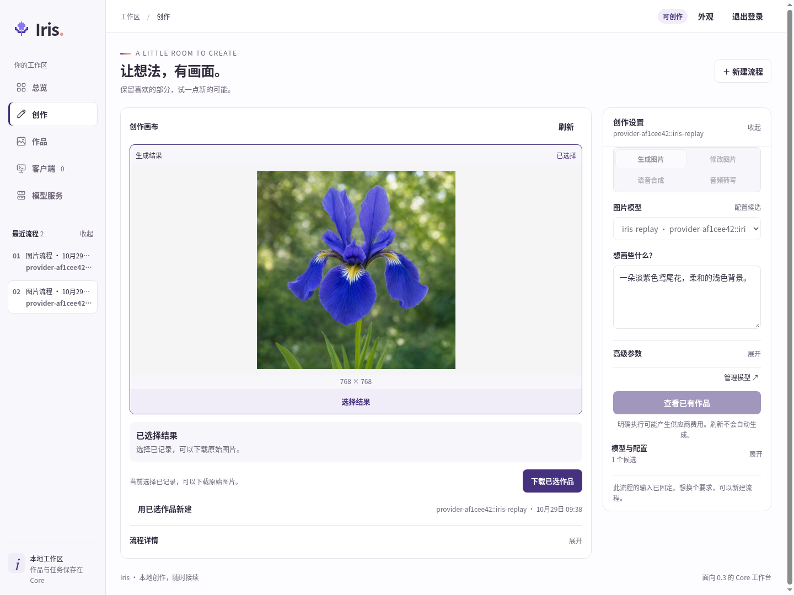
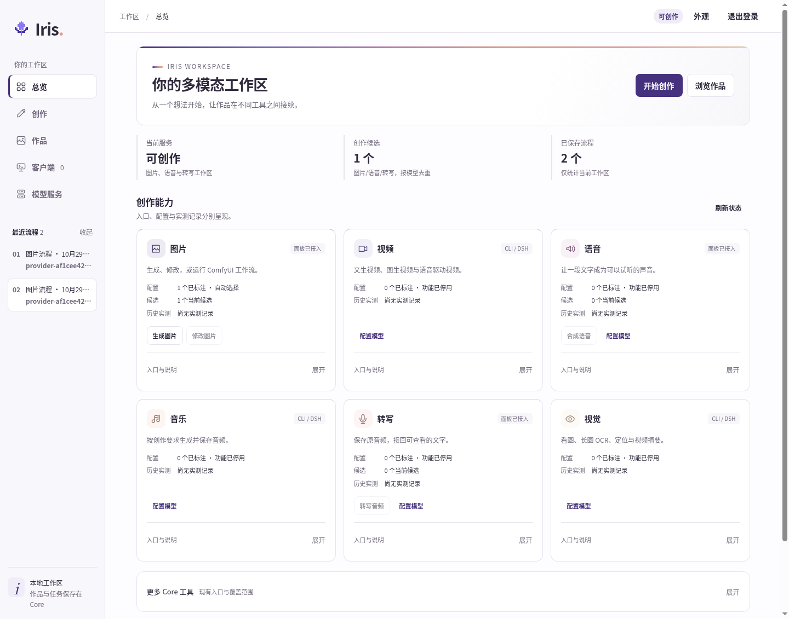
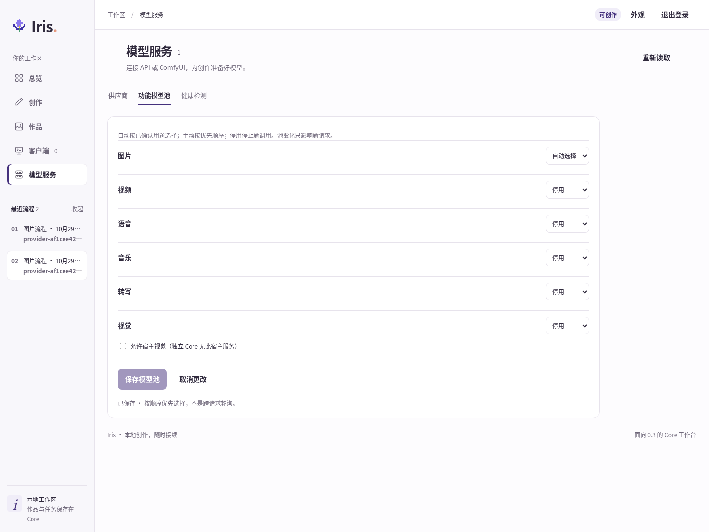
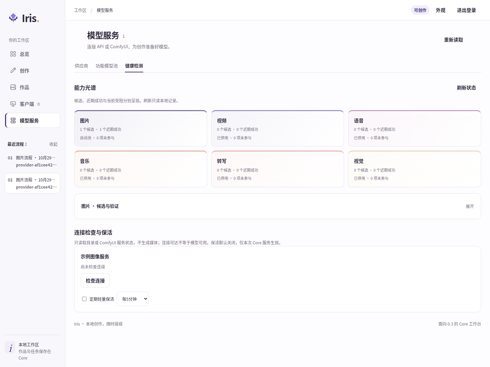
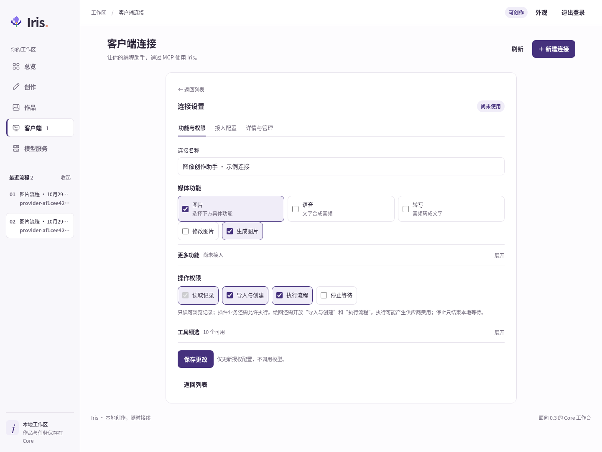
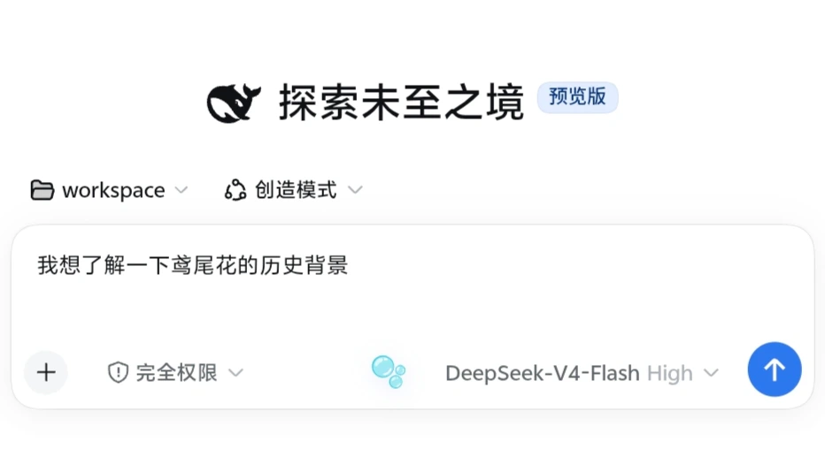
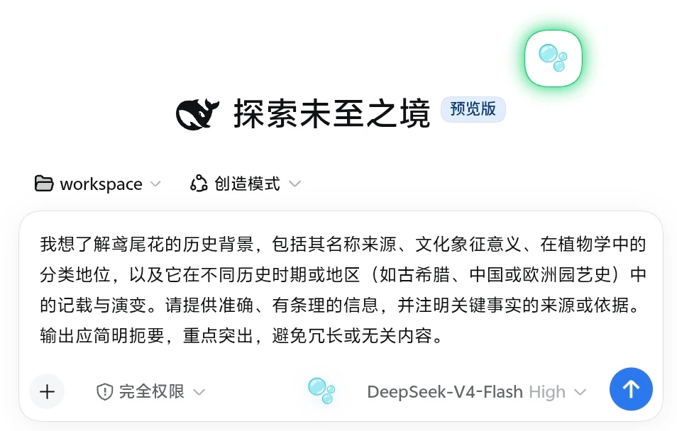
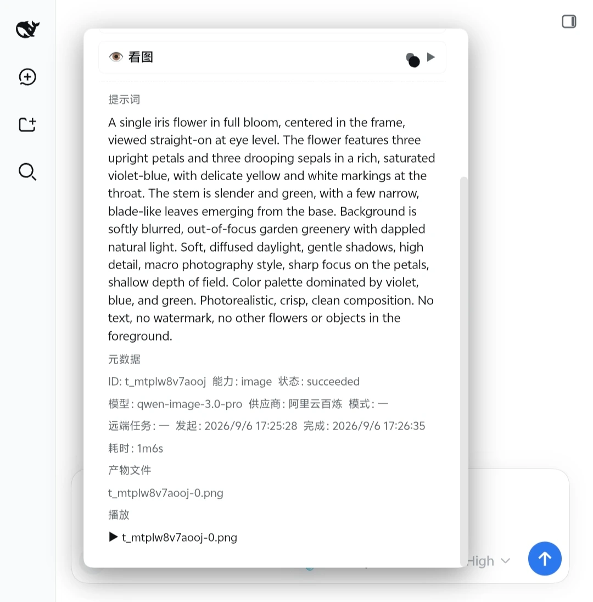

<p align="center">
  <sub><a href="README.md">简体中文</a> | English</sub>
</p>

<h1 align="center">
  <picture>
    <source media="(prefers-color-scheme: dark)" srcset="docs/assets/logo/iris-wordmark-dark.svg">
    <source media="(prefers-color-scheme: light)" srcset="docs/assets/logo/iris-wordmark.svg">
    
  </picture>
</h1>

<p align="center"><strong>A durable, controllable multimodal workspace for your Agent.</strong></p>

<p align="center">
  <a href="https://www.npmjs.com/package/@mokuyoaxis/dsh-iris"></a>
  <a href="https://nodejs.org/"></a>
  <a href="https://github.com/mokuyoaxis/dsh-iris/actions/workflows/ci.yml"></a>
  <a href="LICENSE"></a>
</p>

<p align="center">
  <picture>
    <source media="(prefers-color-scheme: dark)" srcset="docs/assets/logo/iris-anniversary-1128-dark.svg">
    <source media="(prefers-color-scheme: light)" srcset="docs/assets/logo/iris-anniversary-1128.svg">
    
  </picture><br>
  <sub>Nov 28 Anniversary Special Edition · 2026-11-28 &amp; Iris 0.3.3 only</sub>
</p>

Iris brings media model providers, creative workflows, and generated outputs into a single local workspace—so Agents can reliably generate, edit, inspect, and reuse images, video, audio, and vision results.

Built on a shared Core engine, Iris offers four entry points: a **standalone Web workbench**, a **generic MCP server**, a **headless CLI**, and a **native DSH plugin**. Core manages credentials, tasks, and artifacts, while you decide exactly which capabilities each client can access.

> [!NOTE]
> The latest published npm release is **Iris 0.3.2** ([release notes](docs/releases/0.3.2.md)), while `main` includes all **Iris 0.3.3** capabilities ([scope & compatibility](docs/BETA_SCOPE.md) · [changelog](CHANGELOG.md)). If you are upgrading from 0.2.7, a prerelease, or 0.3.0–0.3.2, read the [upgrade guide](docs/UPGRADING_0.3.md) first. Before 0.3.3 is published to npm, run directly from source or a local package archive to test the new features.

| What you want to do | Recommended entry | Availability |
|---|---|---|
| Configure models, create media, and manage works in a browser | [Core quickstart](docs/CORE_QUICKSTART.md) | Standalone workbench for full media & local tools |
| Share the media workspace with any MCP-compatible Agent | [MCP guide](docs/MCP.md) · [Agent guide](docs/AGENT_CORE_QUICKSTART.md) | stdio and Streamable HTTP |
| Use media tools and prompt refinement directly inside DSH | [DSH plugin](#dsh-plugin) | Native tools and lifecycle |
| Generate media, inspect tasks, and export artifacts from a terminal | [Standalone CLI](#standalone-cli) | No DSH required |

## Workbench preview

The Iris workbench pairs a clean light interface with subtle iris accents, light/dark themes, browser-local backgrounds, and responsive mobile layouts. Common actions stay upfront while advanced parameters remain collapsed by default.



| Capability overview | Function model pools |
|---|---|
|  |  |
| **Health spectrum and connection checks** | **MCP capabilities and operation permissions** |
|  |  |

> Captured from the current workbench using an isolated workspace and controlled replay data (no live model or GPU calls were made during capture). See the [full gallery](docs/screenshots.md) for mobile views, dark mode, and provenance.

## What Iris provides

- **Unified multimodal toolkit**: Supports image generation and editing, ComfyUI workflows, t2v/i2v/s2v video, durable music, speech synthesis, audio transcription, single-image vision, and long-image OCR—alongside zero-cost local utilities for cropping, pixel diffing, video frame and tail-frame extraction, audio-video muxing, and HTML screenshots.
- **Per-function model pools**: Configure each of the six capabilities with **automatic selection**, a **manually ordered list**, or **disabled**. Automatic pools only use confirmed, healthy models in a stable order; failover triggers only when a provider clearly rejects acceptance, and existing tasks keep their original model binding.
- **Auditable, retry-safe creative history**: Core persists every Run, Task, Attempt, and Artifact relation with read-only lineage views and one-click cross-mode handoffs. You can inspect original requests, save selections, and build on past outputs. When acceptance status is uncertain, Iris halts rather than re-submitting a potentially billable call.
- **Scoped MCP access**: Each MCP connection defines its own media groups, tool allowlist, and operation scopes (`read`, `create`, `execute`, `stop`), served over stdio or `/mcp` Streamable HTTP against the same Core instance.
- **Explicit plugin extensions**: Extend Iris with custom provider protocols, multimodal durable operations, host-owned schema auto-forms, workbench pages, settings forms, and artifact renderers. The bundled [contact sheet plugin](docs/CONTACT_SHEET.md) shows an end-to-end durable workflow, and you can bootstrap your own from the [plugin starter](docs/PLUGIN_DEVELOPMENT.md) or [Wan Provider template](templates/provider-starter/README.md).

### Current entry-point coverage

| Capability | DSH / standalone CLI | Core Web / MCP (`main` / 0.3.3) |
|---|---|---|
| Image generation, import, editing, and selection | Available | Available (text-to-image requires a generation-enabled root; Web selection and opt-in MCP `iris_core_select_run`) |
| Speech synthesis and transcription | Available | Available in v3 / v4 / v5 roots |
| Durable music generation (`music/v0`) | Available | [Available in v3+ roots](docs/MUSIC.md) (strict single submission with `retried-from` retry lineage; one-click handoff to S2V, muxing, or transcription) |
| Text-to-video, image-to-video (i2v), S2V & frame extraction | Available | [Available in v4 / v5 roots](docs/VIDEO_FLOWS.md) (source frame/audio previews, uniform & tail-frame `mode: "last"` extraction, cross-mode draft handoffs, `T2V`/`I2V`/`S2V` badges & quick filter, and `summarize/v0` drafting) |
| Single-image vision, long-image OCR, visual grounding & media summary | Available | [Available in v5 roots](docs/VISION_FLOWS.md) (OCR enables conservative `boundary-overlap/v0` deduplication verified by a 4-POST live retest; Web supports interactive visual grounding EXIF overlays/cropping and video-frame summary creation) |
| Local tools, inbox/outbox & read-only lineage | CLI / DSH available | Web provides a zero-cost Local Tools panel (EXIF crop, pixel diff heatmap, local `ffmpeg` audio-video muxing `media mux`, opt-in `--browser-executable` HTML render, host-owned plugin auto-forms), `--inbox-dir` import, inline `--outbox-dir` export, read-only lineage, and one-click Copy ID; MCP supports `local-media`, `html-render`, `inbox`, and `outbox` |
| ComfyUI workflows and exposed parameters | Available with a configured workflow | Implemented (live GPU inference pending verification) |
| Contact-sheet plugin | Uses the Core plugin entry | Available when explicitly enabled (host auto-form and dedicated workbench page) |

## Quickstart

### Core workbench

Initialize a **new private directory** for a fresh 0.3 workbench (older 0.2.x workspaces are not migrated automatically; existing 0.3.0–0.3.2 roots work as-is—back up before writing new 0.3.3 recipes):

```bash
npm install @mokuyoaxis/dsh-iris@0.3.2

IRIS_PREVIEW="$HOME/.iris/preview"
mkdir -p "$IRIS_PREVIEW"
npx dsh-iris flow init --data-root "$IRIS_PREVIEW/core"
npx dsh-iris execution init --vision --data-root "$IRIS_PREVIEW/core"
npx dsh-iris config init --provider-config "$IRIS_PREVIEW/providers.json"

npx dsh-iris web serve \
  --data-root "$IRIS_PREVIEW/core" --auth-store "$IRIS_PREVIEW/auth" \
  --provider-config "$IRIS_PREVIEW/providers.json" \
  --allow-provider-management --allow-execution --allow-selection \
  --connection-store "$IRIS_PREVIEW/connections" \
  --allow-connection-management --allow-mcp --port 3182
```

> [!TIP]
> The install command above targets the latest published npm release (`0.3.2`). To run **0.3.3** features from a source checkout, install locked dependencies with `npm ci` and replace `npx dsh-iris` with `node bin/dsh-iris.js`. `execution init --vision` initializes a v5 root enabling image, speech/transcription/music, t2v/i2v/s2v video, and vision/OCR/locate/summarize flows.

1. **Sign in**: Open the **`loginUrl`** printed in your terminal to set an access password, then bookmark the regular address. Devices stay remembered across refreshes and normal restarts.
2. **Add providers**: Under **模型服务** (Model services), add your connection, sync or enter models, confirm their uses, and pick a policy in **功能模型池** (Function pools). Browsing configuration and model catalogs is always read-only; upstream charges only occur when you start a generation.
3. **Connect an Agent**: Under **客户端** (Clients), create a connection with the capabilities and permissions you want, export the MCP config, and merge it into your client. Keep the Core service running for both stdio and HTTP.

See the [Core quickstart](docs/CORE_QUICKSTART.md) and [Agent Core guide](docs/AGENT_CORE_QUICKSTART.md) for recovery details and ready-to-use Agent prompts. Plugins are enabled separately via a [startup selection file](docs/PLUGIN_STARTUP.md).

### DSH plugin

Verify that `dsh --version` matches a supported version in the [compatibility matrix](docs/DSH_COMPATIBILITY.md) (**25 verified versions** in 0.3.3 covering `0.1.2-rc.1` through `0.2.2-rc.5`; 12 in published 0.3.2), with Node.js ≥22.1.0 and `pnpm` on your PATH:

```bash
dsh plugin --profile web add @mokuyoaxis/dsh-iris@0.3.2
dsh web
```

Open **Settings → Iris Workbench** to reference an existing DSH API-key connection or add a media service and approve model uses. Native mode integrates directly with DSH routes, attachments, and lifecycle, exposing 17 Agent tools and the `🫧` prompt-refinement trigger next to the chat composer.

Once configured, try a minimal prompt:

```text
Use iris_draw_image to draw a white cat sitting beside a blue window.
Use Iris to generate retro-rock background music and save it as an audio artifact.
```

See the [user guide](user_guide.md) for full details, or hand the [Agent quickstart prompt](docs/AGENT_QUICKSTART.md) to an Agent for assisted setup. After upgrading, reload the plugin backend and refresh the DSH client.

### Standalone CLI

Install directly in any project without DSH:

```bash
npm install @mokuyoaxis/dsh-iris@0.3.2
npx dsh-iris --help
```

Pass `--data-root` and `--provider-config` to generate media, inspect tasks, and export artifacts—see [Headless CLI](docs/HEADLESS_CLI.md). You can also install the bundled [`iris-core` Skill](docs/CORE_SKILLS.md) into an explicit Skills directory for terminal Agents.

> [!IMPORTANT]
> Always use the full scoped package name **`@mokuyoaxis/dsh-iris`**. The unscoped `dsh-iris` package on npm is a different plugin.

## Design principles & boundaries

- **Explicit actions, no hidden side effects**: Iris never scans your disk for other clients, modifies external configurations, or silently migrates older data roots. DSH mode can [reference host API-key connections](docs/DSH_PROVIDER_CONNECTIONS.md), and Core supports [environment credential references](docs/PROVIDER_CREDENTIALS.md) (storing only the variable name).
- **Single-writer leases & bounded scheduling**: Each physical data root allows one active writer at a time while concurrent readers remain safe. Execution is serial by default; when higher throughput is needed, opt into [bounded media scheduling](docs/MEDIA_SCHEDULING.md) to separately cap HTTP concurrency, dispatch rate, and outstanding remote tasks.
- **Conservative upgrades**: Existing empty configurations and manual pools stay untouched across upgrades, and newly discovered models require explicit approval before entering a pool ([function pools](docs/FUNCTION_MODEL_POOLS.md)). Legacy ai-paint users can run a [one-time explicit import](user_guide.md#从旧工作台显式导入) via `IRIS_IMPORT_WORKBENCH_CONFIG`.
- **Private storage & runtime prerequisites**: Secrets and auth stores are isolated in private directories (typically `0600` files / `0700` dirs on POSIX). Core requires Node.js ≥22.1.0 and `sharp`; video frame extraction and local audio-video muxing require `ffmpeg`/`ffprobe`, and HTML screenshots require a supported browser backend. On Termux/PRoot, place data roots on a private Linux filesystem that supports permissions and hard links.

## Real generation & native DSH

<p align="center">
  
</p>

> Real generation example: starting from “iris flower”, Iris refined the prompt with `deepseek-v4-flash` (thinking off) and generated a 2048×2048 image via DashScope `qwen-image-3.0-pro`.

<details>
<summary>Native DSH on Android 16 / Termux</summary>

| Prompt entry | Refined draft |
|---|---|
|  |  |



Captured from an Android browser connected to DSH running inside Termux/PRoot Debian ARM64. See [the screenshot gallery](docs/screenshots.md) for provenance.

</details>

## Documentation & development

| Topic | Documentation |
|---|---|
| Getting started | [Core quickstart](docs/CORE_QUICKSTART.md) · [Agent Core guide](docs/AGENT_CORE_QUICKSTART.md) · [DSH guide](user_guide.md) · [Headless CLI](docs/HEADLESS_CLI.md) |
| Workbench & access | [Login](docs/WORKBENCH_LOGIN.md) · [Core Web](docs/LOCAL_WEB.md) · [MCP](docs/MCP.md) · [Core Skills](docs/CORE_SKILLS.md) |
| Models & workflows | [Providers, pools & spectrum](docs/PROVIDER_SETTINGS.md) · [Images / ComfyUI](docs/IMAGE_GENERATION.md) · [Video flows](docs/VIDEO_FLOWS.md) · [Speech / transcription](docs/AUDIO_FLOWS.md) · [Music](docs/MUSIC.md) · [Vision & OCR](docs/VISION_FLOWS.md) · [Task semantics](docs/TASK_SEMANTICS.md) |
| Extensions | [Plugin contract](docs/PLUGINS.md) · [Startup](docs/PLUGIN_STARTUP.md) · [Panel & themes](docs/PANEL_EXTENSIONS.md) · [Contact sheet](docs/CONTACT_SHEET.md) |
| Releases & internals | [0.3.2 release notes](docs/releases/0.3.2.md) · [0.3.1 release notes](docs/releases/0.3.1.md) · [0.3.0 release notes](docs/releases/0.3.0.md) · [Upgrade guide](docs/UPGRADING_0.3.md) · [0.2.7 history](docs/releases/0.2.7.md) · [CHANGELOG](CHANGELOG.md) · [ROADMAP](docs/ROADMAP.md) · [Architecture](docs/ARCHITECTURE.md) |

The DSH package includes [`iris-use`](.dsh/skills/iris-use/SKILL.md), [`iris-compose-media`](.dsh/skills/iris-compose-media/SKILL.md), and [`iris-verify-ui`](.dsh/skills/iris-verify-ui/SKILL.md).

The codebase uses ES Modules with no build step—run `npm test` and `npm run lint` to verify changes. Plugins rely on the defined [minimal compatibility surface](docs/BETA_SCOPE.md#最小插件兼容面) while the full SDK continues to evolve.

[MIT License](LICENSE)
