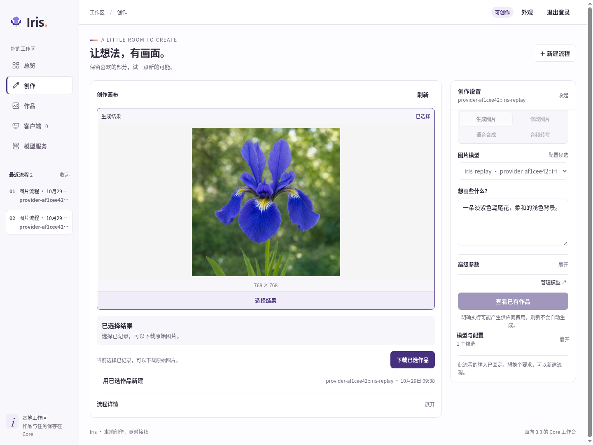
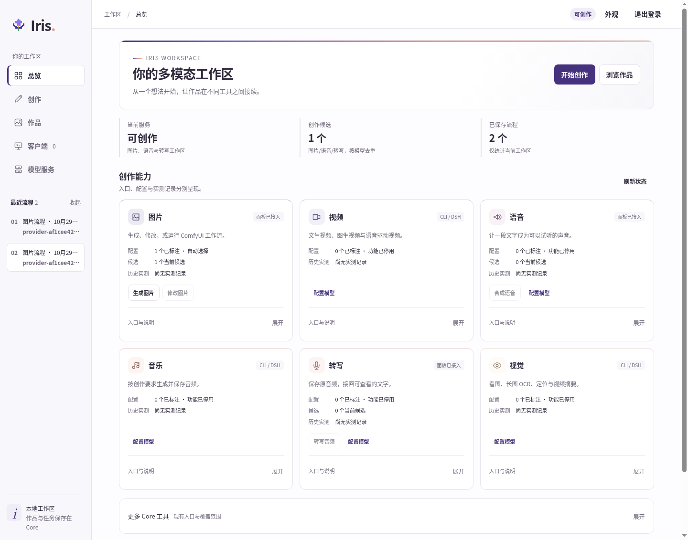
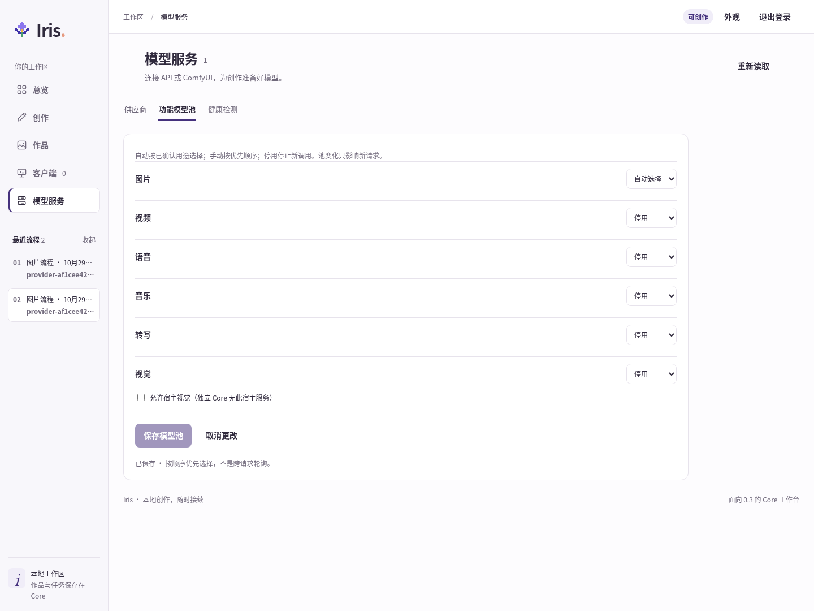
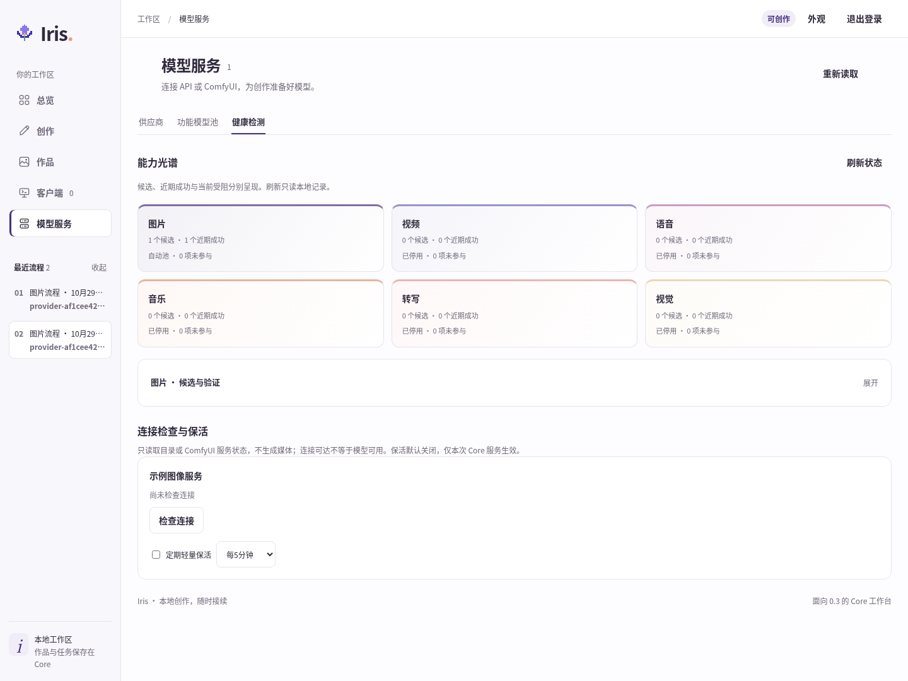
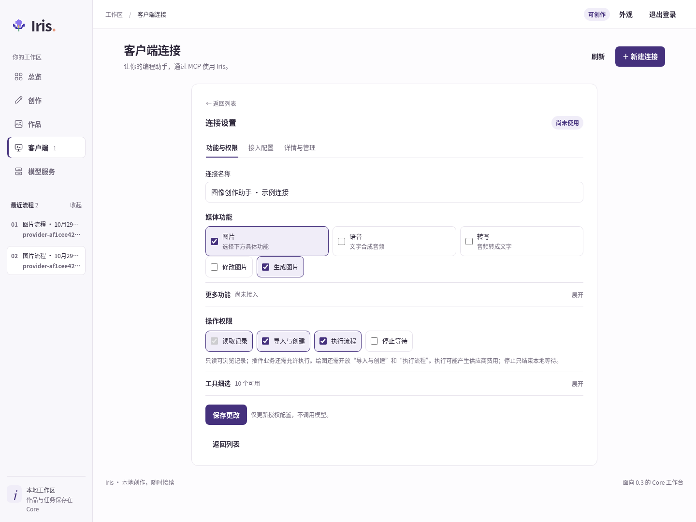
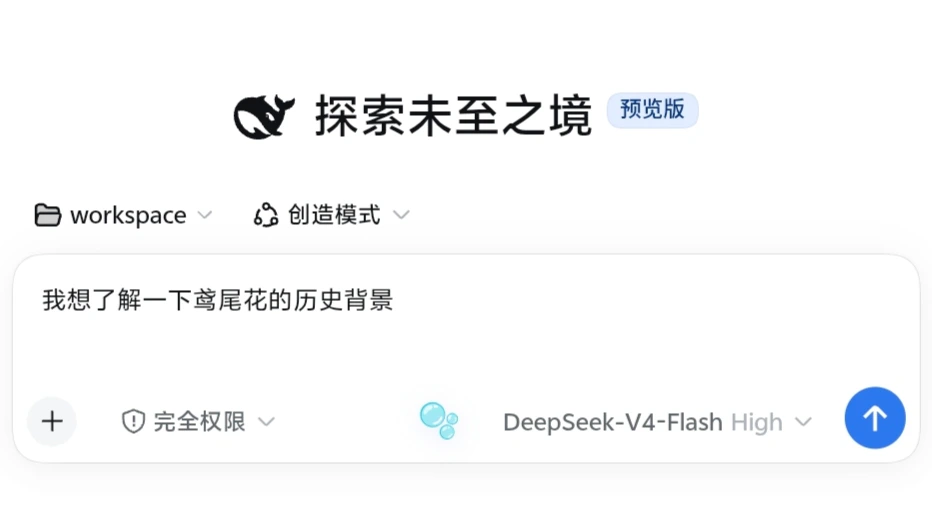
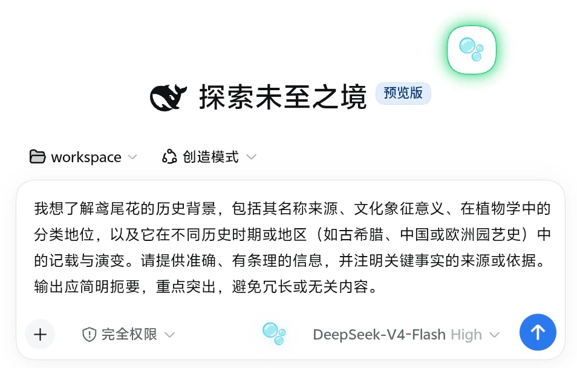
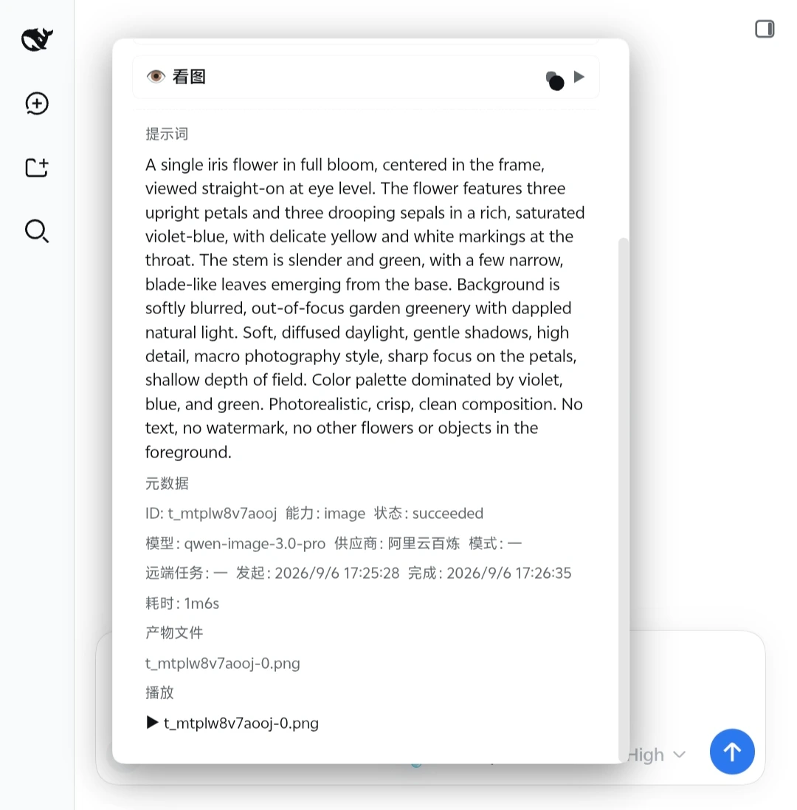

<p align="center">
  <sub>简体中文 | <a href="README.en.md">English</a></sub>
</p>

<h1 align="center">
  <picture>
    <source media="(prefers-color-scheme: dark)" srcset="docs/assets/logo/iris-wordmark-dark.svg">
    <source media="(prefers-color-scheme: light)" srcset="docs/assets/logo/iris-wordmark.svg">
    
  </picture>
</h1>

<p align="center"><strong>给你的 Agent 一个持久、可控的多模态工作区。</strong></p>

<p align="center">
  <a href="https://www.npmjs.com/package/@mokuyoaxis/dsh-iris"></a>
  <a href="https://nodejs.org/"></a>
  <a href="https://github.com/mokuyoaxis/dsh-iris/actions/workflows/ci.yml"></a>
  <a href="LICENSE"></a>
</p>

<p align="center">
  <picture>
    <source media="(prefers-color-scheme: dark)" srcset="docs/assets/logo/iris-anniversary-1128-dark.svg">
    <source media="(prefers-color-scheme: light)" srcset="docs/assets/logo/iris-anniversary-1128.svg">
    
  </picture><br>
  <sub>11.28 纪念日特别版 · 仅限 2026-11-28 与 Iris 0.3.3</sub>
</p>

Iris 将媒体模型服务、创作流程与产物管理统一到一个本地工作区中，让 Agent 可以安全地生成、编辑、查看并复用图片、视频、音频与视觉理解结果。

围绕同一套 Core 引擎，Iris 提供四种使用方式：**独立 Web 工作台**、**通用 MCP 服务**、**Headless CLI** 以及 **DSH 原生插件**。供应商凭据、任务状态与作品均由 Core 统一托管，客户端按你授予的权限获取能力。

> [!NOTE]
> 本文档对应 **Iris 0.3.3**（[发行说明](docs/releases/0.3.3.md) · [支持范围](docs/BETA_SCOPE.md) · [变更记录](CHANGELOG.md)）。若从 0.2.7、预发布版本或 0.3.0–0.3.2 升级，请先阅读[升级指南](docs/UPGRADING_0.3.md)；发布前验证请直接使用源码或本地打包归档。

| 你想做什么 | 推荐入口 | 说明 |
|---|---|---|
| 在独立网页中配置模型、创作与管理作品 | [Core 工作台快速开始](docs/CORE_QUICKSTART.md) | 独立 Web 工作台，覆盖全链路媒体与本地工具 |
| 让其他 Agent 通过 MCP 共用媒体工作区 | [MCP 接入](docs/MCP.md) · [Agent 指导](docs/AGENT_CORE_QUICKSTART.md) | 支持 stdio 与 Streamable HTTP |
| 在 DSH 对话中直接使用媒体工具与提示词优化 | [DSH 插件](#dsh-插件) | 保留原生工具与生命周期 |
| 在终端或脚本中生成媒体、查任务、导出作品 | [独立 CLI](#独立-cli) | 无需启动 DSH |

## 工作台预览

Iris 工作台采用明快简洁的界面与浅鸢尾配色，支持明暗主题、浏览器本地背景及移动端布局；常用操作直接呈现，高级参数与技术细节默认折叠。



| 能力总览 | 功能模型池 |
|---|---|
|  |  |
| **能力光谱与连接检查** | **MCP 能力与操作权限** |
|  |  |

> 以上截图基于当前工作台与受控回放数据拍摄（未产生实际模型或 GPU 调用），来源说明与深色/移动端截图见[完整截图画廊](docs/screenshots.md)。

## 核心特性

- **统一的多模态能力**：覆盖图片生成与编辑、ComfyUI 工作流、文生/图生/数字人视频、持久音乐、语音合成、音频转写、看图问答与长图 OCR，以及裁剪、像素比对、视频抽帧（含尾帧）、音视频合轨和 HTML 截图等零计费本地工具。
- **按功能编排的模型池**：六类能力支持**自动池**、**手动有序名单**或**停用**。自动池仅纳入经你确认用途且健康的模型，按稳定顺序优先选用；只有在确认请求未被供应商受理时才会切换候选，已有任务始终保留原模型绑定。
- **可追溯、防重提的创作记录**：Core 持久记录每次 Run、Task、Attempt 与作品（Artifact）关系，并支持只读血缘视图与跨模式一键接续草稿。你可以随时查看原请求、保存图片选择或基于已有作品继续创作；遇到受理状态未知的异常时，Iris 会停下来等待核对，绝不盲目重发计费请求。
- **精细可控的 MCP 授权**：每条 MCP 连接均可独立选择开放的媒体能力、具体工具与操作权限（`read` / `create` / `execute` / `stop`），并通过同一 Core 的 stdio 桥接或 `/mcp` HTTP 端点对外服务。
- **显式扩展插件**：支持通过插件扩展 Provider 协议、多模态持久业务、宿主托管自动表单、工作台页面、设置表单与作品预览器。随包附带的[多图对照板](docs/CONTACT_SHEET.md)展示了一个端到端的持久插件业务；开发者也可直接从[独立插件模板](docs/PLUGIN_DEVELOPMENT.md)或[万相 Provider 模板](templates/provider-starter/README.md)起步。

### 当前入口覆盖

| 能力 | DSH / 独立 CLI（0.3.3） | Core Web / MCP（0.3.3） |
|---|---|---|
| 图片生成、导入、编辑与选定 | 可用 | 可用（文生图需支持生成的执行根；支持 Web 与显式授权 MCP `iris_core_select_run` 选择作品） |
| 语音合成、音频转写 | 可用 | v3 / v4 / v5 数据根可用 |
| 持久音乐生成（`music/v0`） | 可用 | [v3+ 数据根可用](docs/MUSIC.md)（严格单次提交，支持 `retried-from` 重试血缘；结果可一键接续数字人视频、音视频合轨或转写） |
| 文生、图生（i2v）与数字人（s2v）视频与抽帧 | 可用 | [v4 / v5 数据根可用](docs/VIDEO_FLOWS.md)（支持首帧/音频预览、均匀抽帧与一键取尾帧 `mode: "last"`、跨模式接续草稿、`T2V`/`I2V`/`S2V` 徽标快速筛选与 `summarize/v0` 摘要草稿） |
| 单图看图、长图 OCR、视觉定位与多模态摘要 | 可用 | [v5 数据根可用](docs/VISION_FLOWS.md)（OCR 默认启用保守跨块边界去重 `boundary-overlap/v0` 并已完成 4 POST 真机复测；Web 支持视觉定位 EXIF 叠框/裁剪与视频抽帧摘要创建） |
| 本地工具、收件/出件与只读血缘 | CLI / DSH 可用 | 工作台提供零计费「本地工具」面板（EXIF 裁剪、双图热力图、`ffmpeg` 音视频合轨 `media mux`、显式 `--browser-executable` HTML 截图、宿主托管插件自动表单）、`--inbox-dir` 导入、`--outbox-dir` 内联出件、只读血缘与一键复制 ID；MCP 支持 `local-media`、`html-render`、`inbox` 与 `outbox` |
| ComfyUI 工作流与开放参数 | 可用（需配置受支持的工作流） | 已实现（真实 GPU 推理待独立验收） |
| 多图对照板插件 | 使用独立 Core 插件入口 | 显式启用后可用（支持工作台「扩展业务」自动表单与独立页面） |

## 快速开始

### Core 工作台

为保证数据格式隔离，请为 0.3 工作台指定一个**新的私有目录**（已有旧工作区不会自动迁移；从 0.3.0–0.3.2 升级可直接沿用现有数据根，写入 0.3.3 新配方前请先备份）：

```bash
npm install @mokuyoaxis/dsh-iris@0.3.3

IRIS_PREVIEW="$HOME/.iris/preview"
mkdir -p "$IRIS_PREVIEW"
npx dsh-iris flow init --data-root "$IRIS_PREVIEW/core"
npx dsh-iris execution init --vision --data-root "$IRIS_PREVIEW/core"
npx dsh-iris config init --provider-config "$IRIS_PREVIEW/providers.json"

npx dsh-iris web serve \
  --data-root "$IRIS_PREVIEW/core" --auth-store "$IRIS_PREVIEW/auth" \
  --provider-config "$IRIS_PREVIEW/providers.json" \
  --allow-provider-management --allow-execution --allow-selection \
  --connection-store "$IRIS_PREVIEW/connections" \
  --allow-connection-management --allow-mcp --port 3182
```

> [!TIP]
> 在源码仓库中开发或发布前验证时，运行 `npm ci` 安装锁定依赖，并将命令中的 `npx dsh-iris` 替换为 `node bin/dsh-iris.js`。`execution init --vision` 会初始化 v5 根，一次开启图片、语音/转写/音乐、文生/图生/数字人视频与看图/OCR/定位/摘要流程。

1. **首次登录**：在浏览器中打开终端输出的 **`loginUrl`** 设置访问口令，此后直接访问普通地址即可。登录状态默认在当前设备保留，刷新或正常重启服务后可继续使用。
2. **配置模型服务**：在**模型服务**页面添加供应商、同步或填写模型并确认用途，在**功能模型池**设定策略，即可在**创作**页面生成作品。配置与目录读取均不产生费用，只有发起实际生成或执行才会调用上游服务。
3. **接入 Agent（MCP）**：在**客户端**页面新建连接、勾选权限与工具范围，导出配置并合并到客户端设置中。保持 Core 服务运行即可通过 stdio 或 `/mcp` 使用。

更多登录、恢复、参数说明与 Agent 对话示例，请参阅 [Core 快速开始](docs/CORE_QUICKSTART.md) 与 [Agent Core 指导](docs/AGENT_CORE_QUICKSTART.md)。插件需通过[启动选择文件](docs/PLUGIN_STARTUP.md)显式启用。

### DSH 插件

确认 `dsh --version` 属于[兼容矩阵](docs/DSH_COMPATIBILITY.md)中的 **25 个**受支持准确版本（覆盖 `0.1.2-rc.1` 至 `0.2.2-rc.5`），且环境满足 Node.js ≥22.1.0（DSH `0.2.2-*` 宿主以宿主 Node 要求为准）与 `pnpm`：

```bash
dsh plugin --profile web add @mokuyoaxis/dsh-iris@0.3.3
dsh web
```

在 DSH 的 **设置 → Iris 工作台** 中，可直接引用宿主已有的 API Key 连接，或单独添加媒体服务并确认模型用途。原生模式直接复用 DSH 的路由、附件与生命周期，提供 17 个 Agent 工具和输入框旁的 `🫧` 提示词优化入口。

配置完成后，可以直接在对话中尝试以下最小指令：

```text
使用 iris_draw_image：画一只坐在蓝色窗边的白猫。
用 Iris 生成一首复古摇滚配乐，保存为音频作品。
```

完整操作见[用户指南](user_guide.md)，让 Agent 协助安装可使用 [Agent 简要 Prompt](docs/AGENT_QUICKSTART.md)。升级插件后，按正常流程重载插件后端并刷新客户端页面即可。

### 独立 CLI

无需 DSH，直接在任意项目中安装使用：

```bash
npm install @mokuyoaxis/dsh-iris@0.3.3
npx dsh-iris --help
```

通过显式传入 `--data-root` 与 `--provider-config`，即可完成媒体生成、任务检查与作品导出，详见 [Headless CLI](docs/HEADLESS_CLI.md)。CLI 自带的 [`iris-core` Skill](docs/CORE_SKILLS.md) 也可安装到指定的 Skills 目录中供终端 Agent 使用。

> [!IMPORTANT]
> 安装或搜索时请务必使用完整包名 **`@mokuyoaxis/dsh-iris`**；无 scope 的 `dsh-iris` 是另一款独立插件。

## 设计原则与运行边界

- **显式操作，拒绝隐式副作用**：Iris 不会私自扫描你的磁盘、修改其他客户端配置或偷偷迁移旧版数据。DSH 模式可按需[引用宿主 API Key 连接](docs/DSH_PROVIDER_CONNECTIONS.md)，也支持[环境变量凭据引用](docs/PROVIDER_CREDENTIALS.md)（只保存变量名，运行时由 Core 解析）。
- **单写者租约与有界调度**：同一物理数据根同时只允许一个写者，默认串行执行；只读查询可随时并发。需要更高吞吐时，可显式启用[有界媒体调度](docs/MEDIA_SCHEDULING.md)，分别限制 HTTP 并发、派发速率与远端在途任务数。
- **模型池与版本升级保守演进**：升级或新发现目录模型后，既有空池与手动名单保持不变，新模型须经明确确认用途后才进入可用池，详见[功能模型池](docs/FUNCTION_MODEL_POOLS.md)。需要从旧版 ai-paint 迁移配置时，可通过 `IRIS_IMPORT_WORKBENCH_CONFIG` 执行[一次性显式导入](user_guide.md#从旧工作台显式导入)。
- **私有存储与基础依赖**：密钥与认证数据保存在受权限保护的私有目录（POSIX 通常为 `0600` 文件与 `0700` 目录）。运行基础依赖 Node.js ≥22.1.0 与 `sharp`；视频抽帧与本地音视频合轨需 `ffmpeg`/`ffprobe`，HTML 截图依赖所选浏览器后端。在 Termux/PRoot 环境下，请将数据根放在支持权限位与 hard link 的私有 Linux 文件系统中。

## 实际生成与 DSH 展示

<p align="center">
  
</p>

> 真实生成案例：从提示词“鸢尾花”出发，Iris 先由 `deepseek-v4-flash`（thinking off）优化描述，再经阿里云百炼 `qwen-image-3.0-pro` 生成 2048×2048 原图。

<details>
<summary>Android 16 / Termux 中的 DSH 原生界面截图</summary>

| 对话提示词入口 | 优化后写回草稿 |
|---|---|
|  |  |



以上为 Android 浏览器访问 Termux/PRoot Debian ARM64 中 DSH 的真机界面，详细说明见[截图画廊](docs/screenshots.md)。

</details>

## 文档与开发

| 主题 | 文档 |
|---|---|
| 快速上手 | [Core 快速开始](docs/CORE_QUICKSTART.md) · [Agent Core 指导](docs/AGENT_CORE_QUICKSTART.md) · [DSH 用户指南](user_guide.md) · [Headless CLI](docs/HEADLESS_CLI.md) |
| 工作台与接入 | [工作台登录](docs/WORKBENCH_LOGIN.md) · [Core Web 参考](docs/LOCAL_WEB.md) · [MCP 指南](docs/MCP.md) · [Core Skills](docs/CORE_SKILLS.md) |
| 模型与业务流程 | [模型服务与健康光谱](docs/PROVIDER_SETTINGS.md) · [图片与 ComfyUI](docs/IMAGE_GENERATION.md) · [视频流程](docs/VIDEO_FLOWS.md) · [语音与转写](docs/AUDIO_FLOWS.md) · [音乐生成](docs/MUSIC.md) · [视觉与 OCR](docs/VISION_FLOWS.md) · [任务语义](docs/TASK_SEMANTICS.md) |
| 插件与扩展 | [插件契约](docs/PLUGINS.md) · [启动选择](docs/PLUGIN_STARTUP.md) · [Panel 与外观](docs/PANEL_EXTENSIONS.md) · [多图对照板](docs/CONTACT_SHEET.md) |
| 版本与架构 | [0.3.3 发行说明](docs/releases/0.3.3.md) · [0.3.2 发行说明](docs/releases/0.3.2.md) · [0.3.1 发行说明](docs/releases/0.3.1.md) · [0.3.0 发行说明](docs/releases/0.3.0.md) · [升级指南](docs/UPGRADING_0.3.md) · [0.2.7 历史发行](docs/releases/0.2.7.md) · [CHANGELOG](CHANGELOG.md) · [ROADMAP](docs/ROADMAP.md) · [架构设计](docs/ARCHITECTURE.md) |

DSH 随包附带 [`iris-use`](.dsh/skills/iris-use/SKILL.md)、[`iris-compose-media`](.dsh/skills/iris-compose-media/SKILL.md) 与 [`iris-verify-ui`](.dsh/skills/iris-verify-ui/SKILL.md) 三项 Skill。

开发与测试直接运行 `npm test` 和 `npm run lint`（项目无构建步骤）。插件当前保留[已定义的最小兼容面](docs/BETA_SCOPE.md#最小插件兼容面)，完整 SDK 与内部实现仍在持续演进。

[MIT License](LICENSE)
