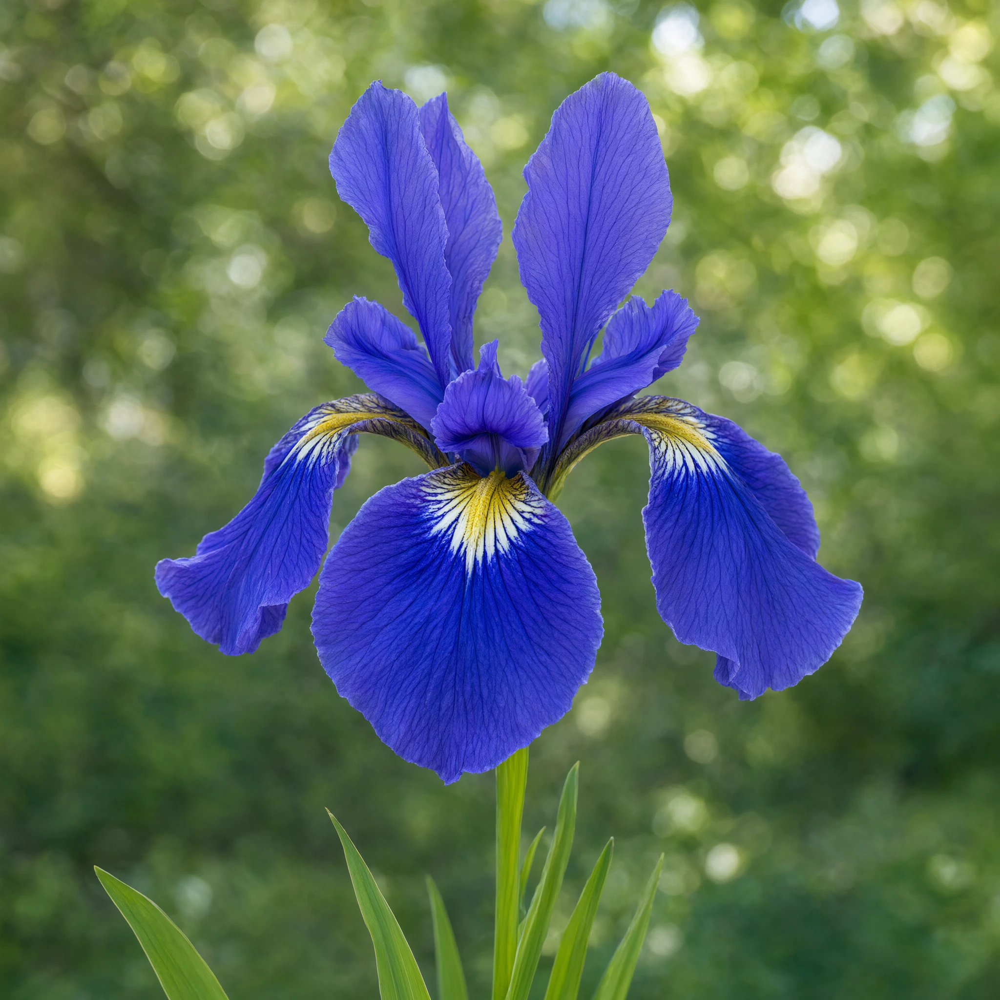
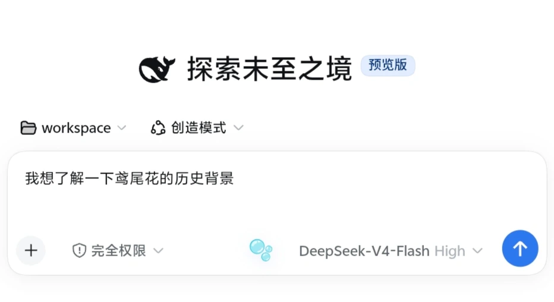
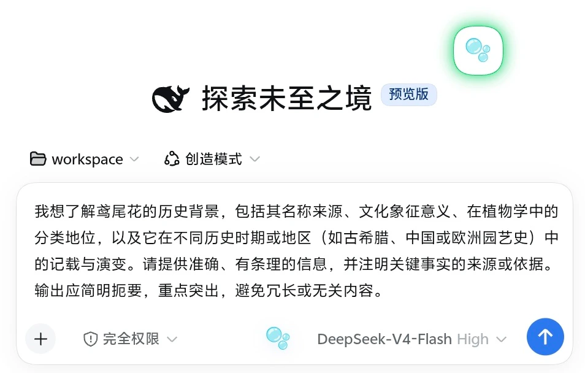
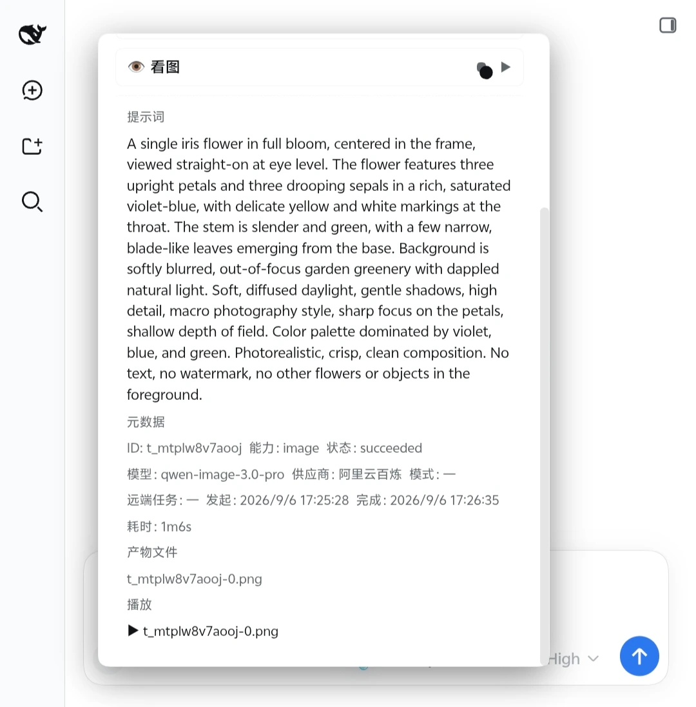
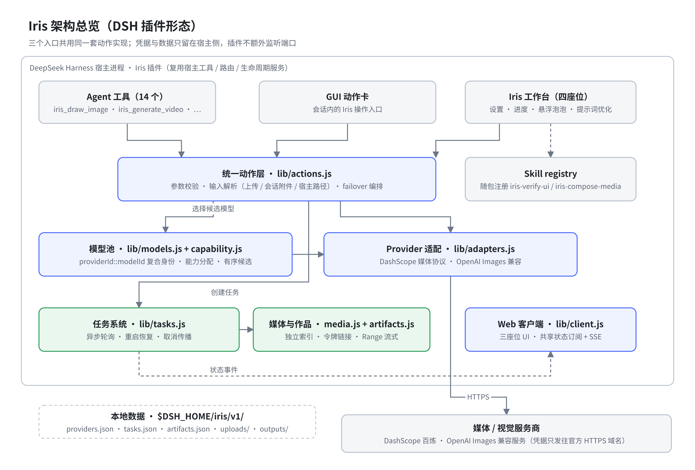
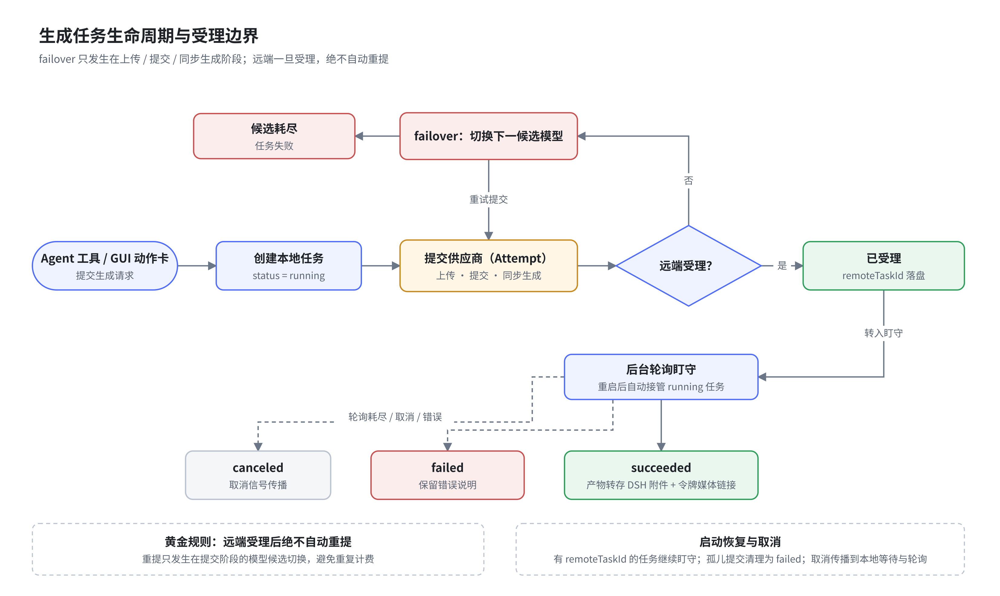
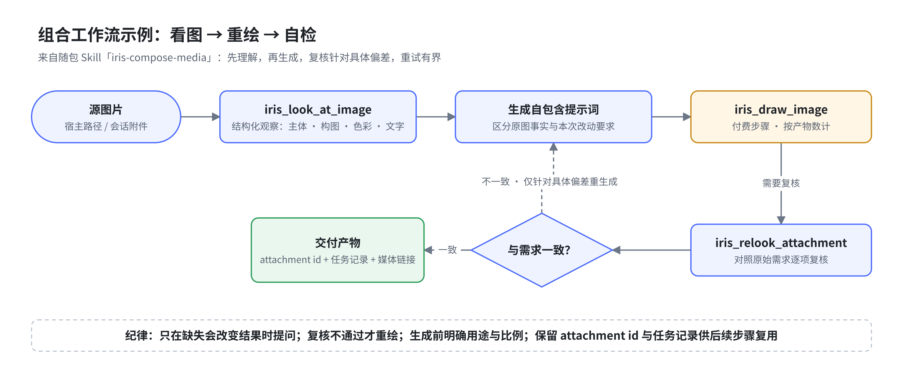

<p align="center">
  <sub>简体中文 | <a href="README.en.md">English</a></sub>
</p>

<p align="center">
  
</p>

<h1 align="center">Iris Media for DSH</h1>

<p align="center"><strong>Iris 多模态生产运行时 · DSH 插件与独立 CLI</strong></p>

<p align="center">
  <a href="#deepseek-harness-适配"></a>
  <a href="https://www.npmjs.com/package/@mokuyoaxis/dsh-iris"></a>
  <a href="https://nodejs.org/"></a>
  <a href="https://github.com/mokuyoaxis/dsh-iris/actions/workflows/ci.yml"></a>
  <a href="LICENSE"></a>
</p>

dsh-iris 为 Agent、Iris 工作台和独立 CLI 提供图像、视频、音乐、语音与视觉理解能力。图片模型可分别连接 DashScope、OpenAI Images、聊天生图或 Responses 接口；音乐支持 Chat Completions 内嵌音频接口。生成作品由共享 Core 管理，可按 Artifact ID 看图、OCR、聊天改图或导出。DSH 工作台集中配置与任务管理，🫧 泡泡提供对话草稿优化入口。

## 实际生成示例

<p align="center">
  
</p>

> 从一句“鸢尾花”开始：Iris 对话框优化 Prompt（`deepseek-v4-flash`，thinking `off`）→ 阿里云百炼 `qwen-image-3.0-pro` 生成 · 2048×2048

## Android 16 真机界面

以下截图来自 Android 浏览器连接 Termux/PRoot Debian ARM64 中的 DSH，使用 DSH 默认皮肤；公开图片均已移除 EXIF/XMP/IPTC 元数据。

| 对话输入区的 🫧 入口 | 优化结果写回输入框 |
|---|---|
|  |  |

<p align="center">
  
</p>

> [查看完整六图流程：优化前、玻璃预览窗、写回、任务成功与实际产物](docs/screenshots.md)

项目目前处于早期版本，接口和配置格式仍可能随版本迭代调整。

当前已发布版本为 **Iris 0.2.6**；未发布改动单独标记。安装与升级请固定版本，并先核对下方的宿主兼容范围。

Iris 0.2.6 同时提供 DSH 插件与无 DSH 的 CLI，共用任务、产物和模型路由。新增连接复用、可选功能自动池、目录同步和能力检测；图片导入、原生 Qwen 改图、音乐、三项 Agent Skills 和同步交付恢复继续可用。Core 内部接口尚未冻结为公共 SDK。

未发布开发版包含宿主截图适配、实际截图地址、主动截图自检、内部应用运行时和 [首版持久改图流程](docs/IMAGE_FLOW.md)，见 [Unreleased](CHANGELOG.md#unreleased)。通用 Recipe/Flow、独立 API 和 Web 工作台继续按 [0.3 路线图](docs/ROADMAP.md#03-及以后)推进。

> 版本支持：Iris 0.2.6 沿用 0.2.5 的 12 个准确 DSH 版本，见 [兼容矩阵](docs/DSH_COMPATIBILITY.md)。保留旧 DSH 时仍需 Node.js ≥22.0.0，宿主若要求更高，以宿主为准。连接复用另需宿主提供对应公开接口。

## 0.2.6 更新重点与现有能力

**选一次连接、确认模型用途，再按功能调用。** 自动池采用稳定顺序和安全切换，没有跨请求轮转。

- **图片导入**：通过工作台、Agent或CLI把已有图片保存为持久作品，继续看图、改图和导出；保留源文件，不调用模型。
- **原生 Qwen 改图**：除聊天生图外，支持DashScope Qwen带图编辑，修改版另存为关联原图的新作品。
- **连接复用与功能池**：可引用 DSH 已有 API Key 连接；六类功能可选自动池、仅用所选模型或停用，确认用途时可同时启用自动池。
- **目录与检测**：自动请求前按需同步目录，明确模型不存在后隔离后续候选；能力检测、目录及高级分区默认折叠，实测单独确认费用。
- **旧宿主与过渡版本**：兼容矩阵中的12个准确版本共用当前功能，manifest、客户端peer和Doctor使用相同范围。

**升级保持已有调用范围**：旧名单和缺失/空分配不会自动启用；需主动选择自动池。新发现模型仍要确认用途，目录未列出不等于下线。DSH 默认视觉需明确加入名单或开启自动池的宿主视觉选项；已有任务按原绑定恢复。详见 [功能模型池](docs/FUNCTION_MODEL_POOLS.md)。

升级与验证边界见 [0.2.6 发布说明](docs/releases/0.2.6.md) 和 [CHANGELOG](CHANGELOG.md)。旧宿主支持见 [0.2.5](docs/releases/0.2.5.md)，图片续作见 [0.2.4](docs/releases/0.2.4.md)，音乐与 Skills 见 [0.2.3](docs/releases/0.2.3.md)。

音乐的接口格式、模型分配与使用示例见 [Music](docs/MUSIC.md)。其他协议与后续能力见 [路线图](docs/ROADMAP.md#后续功能方向)。

## 两条使用路径

| | 路径 A：DSH 插件 | 路径 B：Headless CLI |
|---|---|---|
| 适合谁 | 已在使用 DeepSeek Harness，想要 Agent 工具、工作台和对话内提示词优化 | 想在无 DSH 环境用命令行完成媒体生成、任务跟踪和作品导出 |
| 入口 | 按下文「最快开始」选择固定版本 | `dsh-iris run ...`，见 [Headless CLI](docs/HEADLESS_CLI.md) |
| 数据位置 | `$DSH_HOME/iris/v1/`（Core 数据根 `core-v0`） | 显式 `--data-root` 指定的任意绝对路径 |
| 自动观察 | 有（DSH Host 有界节拍 + 重启接管） | 显式 `task observe`；0.2.2 另提供有界 `task wait` |
| 依赖 | 兼容矩阵中的DSH、Node.js ≥22（满足宿主要求） | Node.js ≥22与`sharp`（视频抽帧另需`ffmpeg`、`ffprobe`） |

两条路径读写同一份 Core Task/Artifact 事实：CLI 可指向 DSH profile 的 `core-v0` 数据根检查或导出作品，反之亦然。只读检查可与写者共存；导出也属于写操作，同一数据根已有写者时会返回 busy。

> 图像处理依赖 `sharp` 及对应平台的二进制。`sharp` 无法加载时也可能阻止 CLI 或插件启动；请先修复依赖安装，再运行 `dsh-iris doctor` 检查环境。

## 可选的旧配置导入

首次使用时，在 Iris 工作台添加供应商或引用 DSH 已有连接。Iris 使用自己的配置，不会默认扫描其他项目。

[引用 DSH 已有连接](docs/DSH_PROVIDER_CONNECTIONS.md)只保存连接标识，在操作时读取宿主管理的地址和密钥；无可复用连接时可手动填写供应商信息。

[功能自动池、手选与停用](docs/FUNCTION_MODEL_POOLS.md)：确认模型用途时可直接启用自动池，免去再次逐项分配。旧名单和空分配保持原行为。

自动池按需同步模型目录（成功缓存 10 分钟），并隔离当前连接已明确返回“模型不存在”的条目。供应商详情默认折叠展示同步结果；失败保留旧目录，新增条目仍待确认用途，手工配置与历史成功保留。

已有旧 ai-paint 配置时，可通过 `IRIS_IMPORT_WORKBENCH_CONFIG` 显式指定来源文件的绝对路径，一次性导入供应商；不修改来源文件、不持续同步。该变量保存文件路径，不包含 API Key。具体操作见[用户指南](user_guide.md#从旧工作台显式导入)。

## 最快开始

先用 `dsh --version` 核对宿主版本，并确认 `pnpm` 在 PATH 中。Iris 与 DSH 的版本号独立；0.2.6 沿用 [兼容矩阵](docs/DSH_COMPATIBILITY.md) 列出的 12 个准确版本。

| 你的 DSH | Iris 选择 | 安装来源 |
|---|---|---|
| 矩阵中的0.1.2/0.1.5/0.1.7/0.2线准确版本 | `0.2.6` | 固定 npm 版本 |
| 未列入矩阵的版本 | 尚未验收 | 按实际宿主接口另行检查 |

### DSH插件：安装0.2.6

安装固定版本到 Web profile：

```bash
dsh plugin --profile web add @mokuyoaxis/dsh-iris@0.2.6
dsh web
```

插件在下一次 DSH 启动时装载。Web UI 默认位于 `http://127.0.0.1:3080`；启动输出带认证参数时请打开完整 URL。更新后需重新加载后端并刷新客户端。

### 独立CLI：安装0.2.6

在自己的项目中安装，无需 DSH：

```bash
npm install @mokuyoaxis/dsh-iris@0.2.6
npx dsh-iris --help
```

需要单独下载时运行`npm pack @mokuyoaxis/dsh-iris@0.2.6`。仍需保留历史Iris0.1.4时可以固定其版本；历史DSH/Node范围见兼容矩阵，0.1.4不包含当前Core媒体CLI及后续新功能。

### dsh-market 安装时的版本选择

市场条目应对应完整包名 `@mokuyoaxis/dsh-iris`。安装前同时核对市场显示的Iris版本与本机 `dsh --version`，按 [兼容矩阵](docs/DSH_COMPATIBILITY.md) 选择对应发行版。市场目录与npm信息可能有缓存，以实际包的顶层 `engines.dsh`、Node要求及客户端peer为准；市场中可见不代表任意DSH版本兼容。

> npm 上无 scope 的 `dsh-iris` 属于另一款插件。安装和更新 Iris Media 时必须保留完整包名 `@mokuyoaxis/dsh-iris`。

首次启动后，打开“设置 → Iris 工作台 → + 添加供应商”，引用 DSH 连接或手动填写地址与密钥，明确媒体协议，再同步目录并确认模型用途。首次配置可同时启用所选功能的自动池；保留手选模式时需选择模型。完整步骤见 [用户指南](user_guide.md) 和 [功能模型池](docs/FUNCTION_MODEL_POOLS.md)。

配置完成后，最小指令可以是：

```text
使用 iris_draw_image：画一只坐在蓝色窗边的白猫。
总结我刚上传的这张图片。
用 Iris 生成一首复古摇滚配乐，保存为音频作品。
用 Iris 总结 /absolute/path/demo.mp4，再把摘要合成为语音。
```

DSH 的 profile 与插件命令由[官方安装说明](https://github.com/deepseek-ai/deepseek-harness/blob/master/docs/user/develop/basic/publish.md)定义。生成图片、视频或语音可能产生供应商费用。

给 AI Agent 的可复制安装与使用提示见 [Agent 简要 Prompt](docs/AGENT_QUICKSTART.md)。

## 功能概览



- 图像生成、文生视频、图生视频和 S2V 数字人视频
- 音乐生成、文本转语音与音频转写
- 看图问答、长图 OCR、目标定位、裁剪和像素差异分析
- 视频抽帧与多模态内容摘要
- 异步任务跟踪、重启恢复和带授权令牌的媒体播放
- 独立作品库：清除任务历史后仍可浏览本地作品，并可重新索引旧 `outputs/`
- 多供应商模型池，以及按 `供应商 + 模型` 分配能力
- 浏览器上传、会话附件和宿主路径三种文件来源
- 独立于工作台的对话框提示词优化，支持当前会话模型与 JSON 固定模型路由

## 使用前准备

- 满足所用 DeepSeek Harness 版本要求的 Node.js；Iris 0.2.x 最低为 22.0.0，旧 npm 0.1.4 的历史要求为 20.10.0
- 一个可用的 DeepSeek Harness 环境，以及 PATH 中的 `pnpm`
- 至少一个受支持的媒体或视觉服务供应商
- 从视频文件抽帧或摘要时，需要系统提供 `ffmpeg` 与 `ffprobe`；复用 Core 帧摘要无需这两个工具

安装插件后，在 Iris 工作台中添加供应商并为所需能力分配模型。供应商密钥保存在宿主侧的 Iris 配置中；POSIX 系统上 Iris 自有目录和文件分别收紧为 `0700` 与 `0600`，界面和接口不会返回完整密钥。Windows 的 mode 不等同于 ACL，仍需依赖当前用户目录和系统账户权限。

## DeepSeek Harness 适配

dsh-iris仍按DSH原生插件装载。0.2.6服务端注册17个Agent工具，包含图片导入、改图与音乐；使用宿主提供的路由、附件、模型和生命周期能力。Web客户端接入设置页、会话输入区与全局悬浮层，不启动额外服务或监听端口。

上传图片或本地图片可保存为持久作品，继续看图、改图及导出，见 [图片导入](docs/IMAGE_IMPORT.md)。

| Iris 范围 | DSH 范围 | 验证记录 |
|---|---|---|
| 已发布稳定版 `0.1.4` | `>=0.1.2-rc.1 <0.1.3-0` | 历史 Linux ARM64 干净与日常 Web profile 验收 |
| 已发布稳定版 `0.1.4` | `0.1.5-rc.1` | 历史 Android/Linux 日常 profile 验收 |
| `0.2.0` | 仅 `0.2.0-rc.2` | 真实安装服务隔离验收、Core diff 与 SlotRegistry；已有用户实机演示反馈，逐项浏览器操作与异步重启/回退继续验收 |
| `0.2.2` | 仅 `0.2.0-rc.2` | 真实安装服务隔离检查覆盖 15 个工具与 31 项边界；完整浏览器/移动端及真实异步重启验收仍待完成 |
| `0.2.3` | 仅 `0.2.0-rc.2` | 增加音乐工具和第三项 Skill；升级后用宿主诊断检查实际装载 |
| `0.2.4` | `0.2.0-rc.2` 或 `0.2.1-alpha.4` | 17工具/3项Skill；两版实际SDK、加载器与界面插槽隔离验收，完整浏览器/热更新另验 |
| `0.2.5` | 0.1.2/0.1.5/0.1.7/0.2线的12个准确版本，见兼容矩阵 | 每版官方SDK隔离检查，包含Music与Qwen工具链；旧profile另通过实际安装包装载 |
| `0.2.6` | 沿用0.2.5的12个准确版本 | 新增连接复用、功能池与目录；连接引用按宿主公开服务检测，具体边界见本版发布说明 |

当前声明与验收范围见 [版本兼容](docs/DSH_COMPATIBILITY.md)，早期rc.2修正见 [历史适配记录](docs/DSH_RC2_ADAPTATION.md)；npm0.1.4不包含这些后续适配。

0.2.5按宿主实际接口能力适配，按已验证的准确版本声明支持。未列出的版本需另行验收。自动化检查分别覆盖服务端装载、工具与Skill注册、路由及客户端Slot；完整浏览器操作与旧数据升级另行验收。Doctor会指出当前可观察到的具体边界。

Core 与 DSH Adapter 正在分离，DSH 继续加载同一个 npm 包，Adapter 把宿主能力映射给 Core。若 DSH 修改 API，修复应限制在 Adapter 和客户端桥接；Core 的任务和产物语义不随宿主版本改变。0.2.0 已提供无 DSH CLI；第二个真实 Host Adapter 完成并验收后再移除名称中的 `dsh` 前缀，届时发布新的 npm 包，见[路线图](docs/ROADMAP.md)。

## 工具

### 生成、语音与任务

| 工具 | 用途 |
|---|---|
| `iris_draw_image` | 根据提示词生成图片 |
| `iris_import_image` | 将本地图片或会话图片保存为持久作品，返回后续操作使用的作品ID |
| `iris_edit_image` | 按原图 Artifact ID 和修改指令创建关联来源的新图片（聊天生图或已接入的原生 Qwen 改图模型） |
| `iris_generate_video` | 生成文生视频、图生视频或 S2V 数字人视频 |
| `iris_generate_music` | 根据描述生成音乐，保存为可试听、下载的音频作品 |
| `iris_speak_text` | 将文本合成为语音 |
| `iris_transcribe_audio` | 将音频转写为文本 |
| `iris_task_status` | 查询单个任务或最近任务的状态和产物 |

### 视觉与图像处理

| 工具 | 用途 |
|---|---|
| `iris_look_at_image` | 对图片提问并获得视觉模型回答 |
| `iris_relook_attachment` | 使用新问题重新查看会话中的图片附件 |
| `iris_long_ocr` | 分块识别长截图或长图文字 |
| `iris_locate` | 定位图片中的目标并返回像素坐标 |
| `iris_crop` | 按像素区域裁剪图片 |
| `iris_pixel_diff` | 比较两张图片并生成差异统计和热力图 |
| `iris_html_screenshot` | 在受限环境中将 HTML 字符串渲染为截图 |

### 视频处理

| 工具 | 用途 |
|---|---|
| `iris_video_frames` | 从视频中均匀抽取画面帧 |
| `iris_media_summarize` | 结合画面帧和可选音频转写生成视频摘要 |

## 文件输入

看图、定位和 OCR 可使用本地路径、会话附件或 Core 图片 `artifact_id`；摘要可直接复用 `frame_artifact_ids`。Artifact 输入只读核验 MIME 与内容哈希，无需原文件或临时导出，PNG/JPEG/WebP 不需要用户先转成 JPG。命令示例见 [视觉 CLI](docs/VISION_CLI.md)。

看图、OCR 每块、定位和聊天改图按账号/模型预算准备发送副本，默认 8 MiB，可调整大小与最长边；Core 原图、下载尺寸和哈希保持不变。OCR 标明缩小后的实际尺寸与细字风险，定位返回原图像素坐标。详见 [视觉输入预算](docs/CLI_MANAGEMENT.md#看图输入预算)。

Core图片改图直接使用来源ID，修改版另存为新作品；[改图](docs/CLI_MANAGEMENT.md#artifact-聊天改图)支持聊天生图协议及0.2.4的DashScope原生Qwen改图。作品分页、过滤、跨页选择、下载与回收操作见 [工作台作品管理](docs/WORKBENCH_ARTIFACTS.md)。

Iris 支持三种文件来源，推荐顺序如下：

1. **浏览器上传**：适合本地文件和跨环境访问，单文件上限为 64 MB。
2. **会话附件**：适合复用当前会话中已经上传或生成的媒体。
3. **宿主路径**：适合宿主可以直接读取的大文件。这里填写的是宿主进程看到的路径，不一定等同于浏览器所在系统的路径。

上传内容保存在 `$DSH_HOME/iris/v1/uploads/`，默认保留 7 天。不同系统下的路径选择建议见[文件访问与跨环境](docs/file-access-across-environments.md)。

## 对话框提示词优化

0.2.2 在既有按次规则、只组装和可编辑对照预览上增加一般功能。一般功能可折叠，提供通用、画图、改图、视频与数字人用途，默认忠实整理保留原文和句序；改写表达需明确选择，补充建议单独获取和采纳。默认指令贴近项目 Skills，既有自定义 v1 配置与旧 API 文字协议保留。规则不持久化，未新增独立提示词 CLI。功能及边界见 [提示词优化系统](docs/PROMPT_OPTIMIZER.md)。

Iris 会在 DSH 对话输入区提供一个无边框、无文字的“🫧”入口，不需要打开 Iris 工作台。点击后打开带背景模糊、半透明层次和柔和光影的玻璃悬浮窗；桌面端靠近输入区显示，窄屏与 Android 浏览器自动切换为带安全区和内部滚动的底部面板。它只读取当前未发送的纯文本草稿；结果先预览，用户确认后才写回输入框，不会自动发送。含 `@` 或 `/` 结构化引用的草稿暂不改写，以免引用身份丢失。

默认使用当前会话选中的主模型；会话尚未选定模型时回退到 DSH 默认模型。优化请求不携带聊天历史、工具、附件或工作区，只发送当前草稿与目标模板。为避免推理模型在正文前耗尽生成预算，默认 `generation.reasoningEffort` 为 `off-if-supported`：仅在 DSH 模型元数据明确支持关闭 thinking 时禁用推理，否则使用供应商默认值，并且不再继承主会话的 High/Low 档位。可在 JSON 中改为 `provider-default`、`inherit` 或模型声明的具体 effort ID；成本与稳定性优先时，建议使用 `fixed` 路由指定轻量非思考模型。用户也可以导出 `prompt-optimizer.json`，将 `route.mode` 改为 `fixed` 并指定其他已在 DSH 注册的 `provider` 与 `model`，然后从面板重新导入。面板提供“恢复默认”，可还原 Iris 内置 Prompt、目标模板、会话模型路由和生成参数。该对话入口可以单独关闭，并从 Iris 工作台重新启用；关闭不会停用工作台、Agent 工具或任务后台。优化调用可能产生对应文本模型的费用。

## 模型分配与故障转移

Iris 按功能组织有序模型候选池，能力分配使用 `providerId::modelId` 区分执行器。同名模型来自不同供应商或账号时是独立选项；阿里云百炼可为媒体请求单独配置 Workspace `mediaBaseUrl`。

0.2.2 只采用明确功能标签、旧能力字段绑定或供应商能力元数据，裸账号和名称不再自动赋能。发现保留未标注模型，可在工作台“设置功能”或 CLI `models caps` 中明确用途；已有明确标签优先，分配顺序和安全切换保持。旧 0.2.1 的裸账号与模型名称推断不再用于功能赋能。

生成类能力可以配置多个候选模型。每次请求都从有序列表首项开始，并非 round-robin；Iris 只有在供应商明确证明未受理时才会尝试下一个候选；500、超时、断网、响应缺失、轮询失败和本地落盘失败都不会授权自动重提。远端服务一旦受理任务，Iris 只会恢复观察或交付，以免产生重复任务或重复计费。音乐入口另外支持按本次参数执行有限的 502 重试，每次重发建立新任务，可能消耗额外额度；可设置 `retry_502: 0` 关闭，见 [Music](docs/MUSIC.md)。

工作台把观察暂停、受理/结果未知和生成成功但交付失败单列为“需要处理”。“重新观察”不会提交；“重新交付”不会重新生成；“标为已读/恢复提醒”只改变本地提醒队列；只有“知情重试”会创建新任务，并要求用户逐次确认潜在重复费用。新任务创建后，原提醒自动归档但保留未知事实和新旧任务关联。任务语义、架构、安全边界与故障证据分别见 [`TASK_SEMANTICS.md`](docs/TASK_SEMANTICS.md)、[`ARCHITECTURE.md`](docs/ARCHITECTURE.md)、[`SECURITY.md`](docs/SECURITY.md) 和 [`FAULT_INJECTION.md`](docs/FAULT_INJECTION.md)。



转写是独立的 `transcribe` 能力，不会占用 TTS 或视觉能力的模型配置。

## 能力健康与模型验证

工作台与主泡泡用颜色和文字显示健康状态：灰色未配置，蓝色待验证，绿色表示对应“供应商 × 模型 × 能力”7 天内成功，暗红色表示明确认证/权限失败。0.2.2 另以琥珀色显示短时 429 冷却，红色显示已确认额度或预算耗尽，并给出原因和恢复条件。

Iris 不做后台探测。短时 429 遵从 `Retry-After`，缺失时冷却 60 秒；到期恢复候选资格，不自动调用验证。明确免费额度或预算耗尽则停用至手动实测成功，重启后仍跳过；实测按钮保持可用。模型池可逐项实测视觉、图片和 TTS，视频与转写可用 CLI 实测命令提供真实素材。网络、5xx、内容安全、取消和受理未知不覆盖近期成功。Host Doctor 只核验装载与 Host Port。完整规则见 [Provider 与能力健康状态](docs/PROVIDER_HEALTH.md)。

## 离线诊断

无需安装或启动 DSH，也不会发送供应商请求：

```bash
npx @mokuyoaxis/dsh-iris doctor
npx @mokuyoaxis/dsh-iris doctor --json
```

安装后的二进制名是 `dsh-iris`。退出码 `0` 表示正常、`1` 表示有警告、`2` 表示有硬错误。离线 Doctor 检查 Node、sharp、ffmpeg/ffprobe、数据目录真实写入、配置、模型/分配、任务语义、临时文件和孤儿/缺失产物。

运行中的 DSH 另在 Iris 工作台提供“宿主诊断”卡片及受 Host/浏览器来源守卫保护的 `/iris/api/doctor` JSON，检查宿主版本、插件、17 工具/3 项 Skill、四组路由、宿主能力、客户端版本和四个 UI Slot。该守卫不提供身份认证。诊断只读取安全快照与注册证据，不调用 Browser、模型或 Provider，详见 [Host Doctor](docs/HOST_DOCTOR.md)。

## 组合工作流示例

三项 Agent Skills 分别指导单步媒体操作、多步骤创作与界面验收。下图是既有「看图 → 重绘 → 自检」示例；检查按用户目标加入，已有作品和部分结果保留，音乐作为可选素材步骤。



仓库的 [`docs/assets/diagrams/`](docs/assets/diagrams/) 另提供 SVG 版本与可编辑 drawio 源文件；npm 包只随附 README 直接展示的 PNG。

## 数据与任务

运行数据默认位于 `$DSH_HOME/iris/v1/`：

| 位置 | 内容 |
|---|---|
| `providers.json` | 供应商、能力分配和脱敏健康证据，文件权限为 0600 |
| `prompt-optimizer.json` | 用户导入的优化 Prompt、目标模板、模型路由和生成参数，文件权限为 0600 |
| `core-v0/` | 新任务、Attempt、Artifact 对象、Manifest 与可恢复隔离事务 |
| `tasks.json` | 旧版任务元数据和附件索引，最多保留 500 条 |
| `artifacts.json` | 旧版作品库最小索引与随机访问令牌，不含 Prompt、Provider 或任务关系 |
| `outputs/` | 旧版生成和处理后的媒体文件 |
| `uploads/` | 浏览器上传的临时输入副本 |

0.1.1 首次装载时会收紧既有 `$DSH_HOME/iris/v1/` 树的 POSIX 权限，不修改文件内容，也不跟随符号链接。大媒体下载采用流式私有临时文件与原子替换，不再把整段视频载入内存。

异步任务会在后台轮询。插件重启后，可以继续接管仍在远端执行的任务。取消信号会传递到本地等待与轮询流程；是否能取消远端计算，取决于供应商接口。

作品库与任务历史相互独立：清理终态任务不会删除作品，新旧媒体可在工作台分页浏览，也可用“找回本地作品”重新扫描 `outputs/`。旧版作品删除会删除实际文件并单独确认，见 [作品库 v0](docs/ARTIFACT_LIBRARY.md)；Core 作品先预览，再移入可恢复回收区，见 [作品管理](docs/WORKBENCH_ARTIFACTS.md)。收藏、标签和搜索仍为后续功能。

旧版媒体通过带随机令牌的链接访问；Core 媒体以随机 Artifact ID 读取，受宿主与浏览器来源守卫保护。图片会尽量转存为 DSH 持久附件，方便在会话中继续使用。

## 安全说明

- 供应商密钥不会通过状态接口返回。
- DashScope 媒体协议只允许把密钥发送到阿里云官方 HTTPS、地域或 Workspace 域名；可用独立 `mediaBaseUrl` 与视觉/对话端点分流，其他地址默认推断为 OpenAI Images 兼容协议。
- `/iris/*` 默认只接受回环 Host；LAN 或反向代理必须显式设置 `IRIS_TRUSTED_HOSTS`，修改状态的请求还会检查跨站来源。
- `IRIS_TRUSTED_HOSTS` 不是认证机制。对公网或不可信网络开放 DSH 时，必须在反向代理或宿主层配置身份认证与 HTTPS。
- 模型实测只按单项能力运行，并在真实供应商调用前确认；视频和转写不会用空样本自动提交付费探针。
- HTML 截图在不具备同源权限的沙箱页面中渲染，脚本和外部网络默认不可用。
- 旧版媒体链接使用随机能力令牌，Core 媒体按 Artifact ID 核验内容哈希；宿主 allowlist 不替代用户认证。
- Iris 不提供独立账号体系，多用户隔离和访问控制由 DeepSeek Harness 部署负责。

## 已知限制

- `sharp` 包含原生组件；主要支持 glibc Linux、Windows 和 macOS。裸 Termux 等非标准运行环境可能需要额外处理。
- 视频文件抽帧和摘要依赖系统安装的 `ffmpeg` 与 `ffprobe`；复用 Core 帧无需这两个工具。
- HTML 截图不加载远程脚本、字体或图片；需要的资源应先内联。
- WSL、容器和远程部署中，浏览器路径通常不能直接交给宿主读取，请优先上传文件。
- 供应商返回的模型清单只是候选集合，模型是否真正支持某项能力仍以实际调用为准。

## Agent Skills

插件通过 DSH Skill registry 注册三项随包 Skill：

| Skill | 适用场景 |
|---|---|
| [`iris-use`](.dsh/skills/iris-use/SKILL.md) | 单步生成、改图、看图/OCR、语音、音乐、查询与作品交付 |
| [`iris-compose-media`](.dsh/skills/iris-compose-media/SKILL.md) | 图片版本、视频素材、旁白、S2V和可选配乐等多步骤创作 |
| [`iris-verify-ui`](.dsh/skills/iris-verify-ui/SKILL.md) | 界面还原与截图验收，区分通过、部分通过、失败和证据不足 |

Skill 不依赖会话工作目录，项目中的同名 Skill 仍优先；宿主未提供 registry 时，工具仍可独立使用。三项共享[能力与产物说明](.dsh/skills/iris-use/references/media-contract.md)，区分Core ID、附件、播放链接和文件输入；TTS用于后续文件处理时先导出。

用户想稳定指定方法时，可直接用 DSH 的 `/name` 形式：

```text
/iris-use 生成一首摇滚配乐，返回音频作品和播放链接

/iris-compose-media 分析我上传的产品照，生成同构图海报，再检查是否符合要求

/iris-verify-ui 对比当前截图和参考图，定位偏差并给出有证据的结论
```

也可以自然语言请求或直接指定工具。单步操作由iris-use指导，多步骤由编排Skill指导；音乐仅在用户要求时加入。Skill不能替代工具装载或模型分配，也不改变任务、费用确认和安全边界。

## 开发与验证

在项目目录运行：

    npm test

测试覆盖配置合并、模型身份、任务生命周期、生成动作、HTTP/SSE 路由、客户端交互和安全边界。项目采用 ES Modules，不需要构建步骤。

测试调度使用 Node.js，逐文件启动独立进程，首个失败即停止，不依赖 Bash；临时目录使用系统 API 并在退出时清理。GitHub Actions 定义 Linux/Windows × Node.js 22.0.0/最新 22.x 矩阵，并在最低版本重复检查进程自然退出；发布前钩子会重新运行完整测试。原生 Windows/WSL 的 DSH 宿主烟测仍待实机验证。

发布由 `v*` 标签触发 `.github/workflows/release.yml`：跑完整测试后打包，用工作流内置 `GITHUB_TOKEN` 创建 GitHub Release（附 tarball，发布说明优先取自 `docs/releases/<版本>.md`，否则取 CHANGELOG 对应章节），并在配置了 `NPM_TOKEN` secret 时发布到 npm。本机无需任何 GitHub 凭据。

## 文档

- [用户指南](user_guide.md)
- [变更记录](CHANGELOG.md)
- [路线图](docs/ROADMAP.md)
- [文件访问与跨环境](docs/file-access-across-environments.md)
- [Android 16 真机截图画廊](docs/screenshots.md)
- [Task/Attempt v2 语义契约](docs/TASK_SEMANTICS.md)

## License

[MIT](LICENSE)
