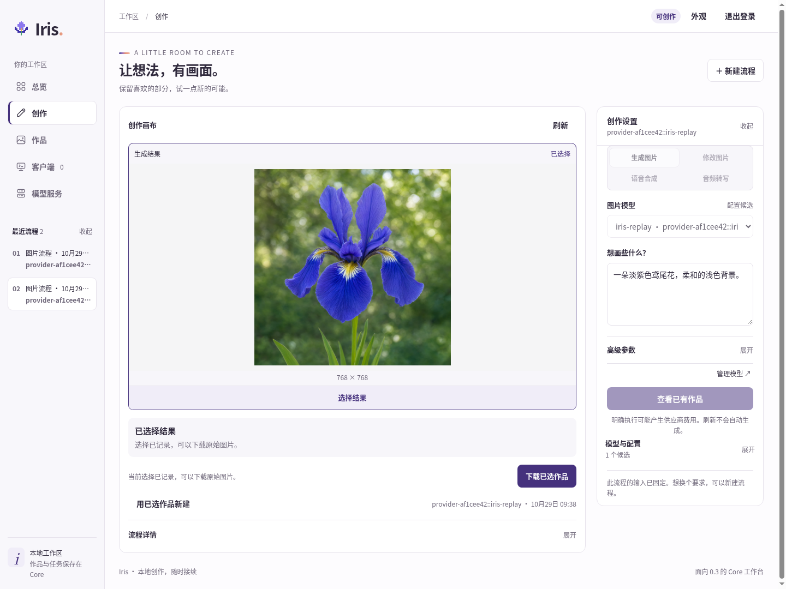
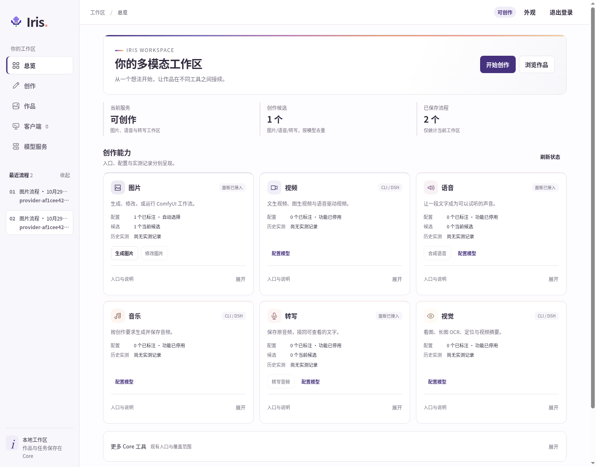
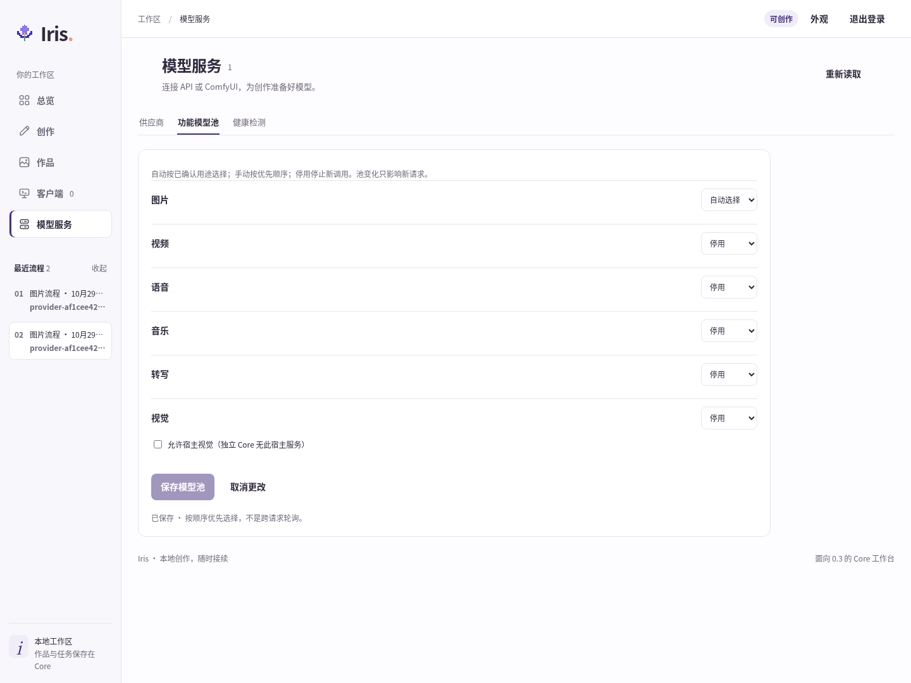
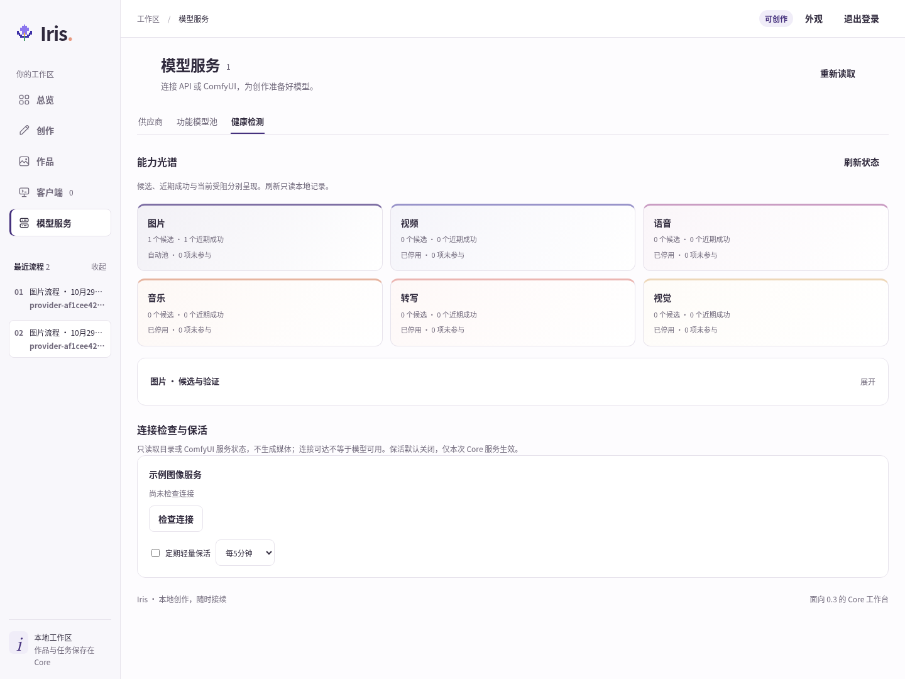
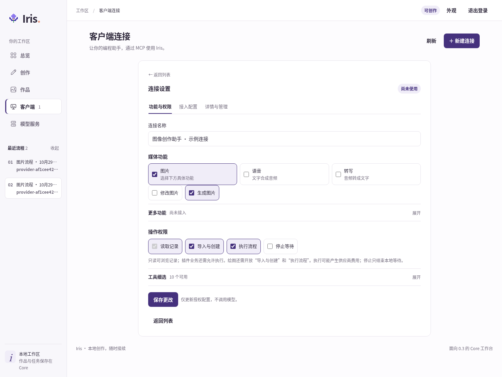
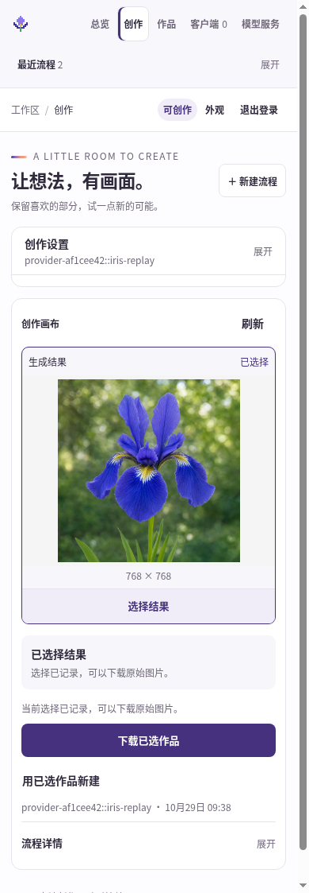
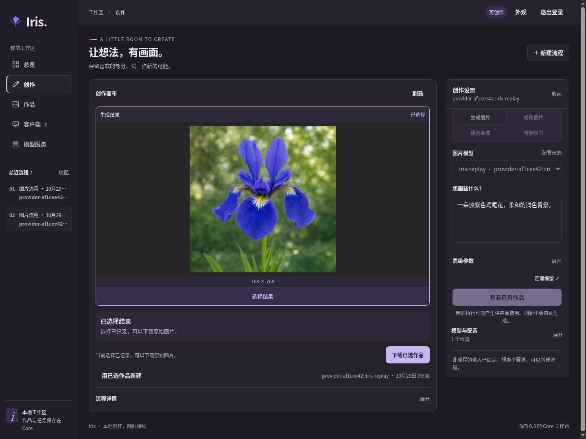
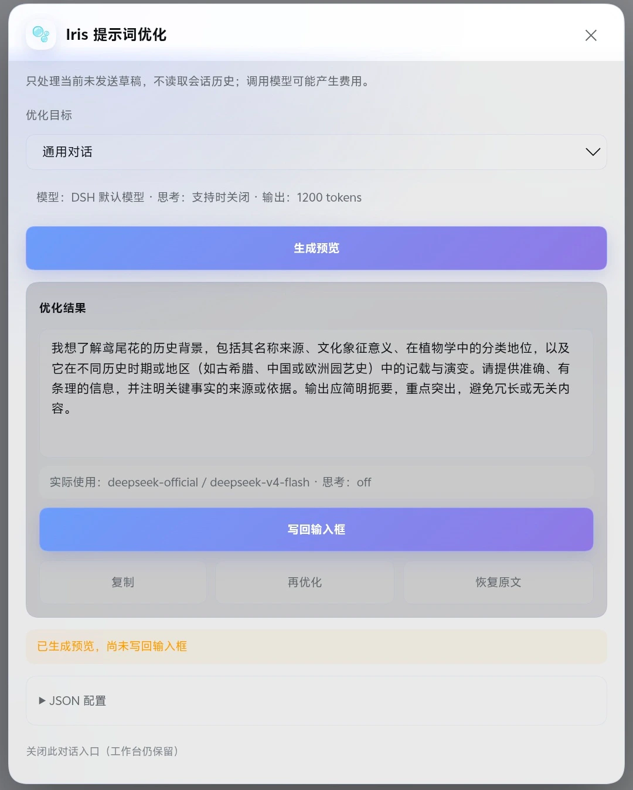
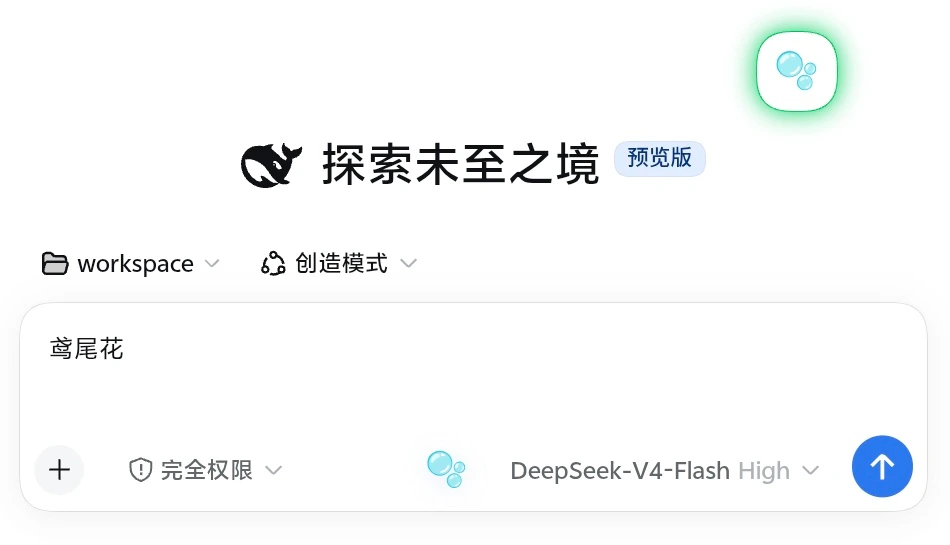
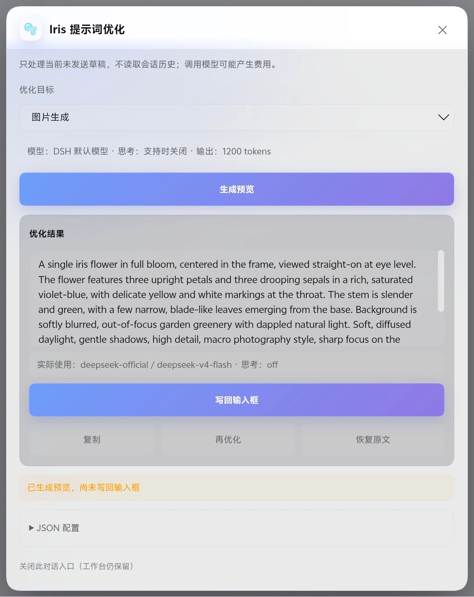

# Iris 界面与生成来源 / Screenshots and provenance

## Core 工作台开发预览 / Core workbench development preview

2026-10-29 重拍，使用当前未发布源码、独立演示数据根及 Chrome for Testing 153.0.8010.12（Linux ARM64）。全新浏览器 profile 只使用内置明亮/暗色主题；流程与作品是此前从零使用演练已完成记录的独立副本，没有读取用户背景、真实供应商凭据或日常浏览器会话。

Recaptured on 2026-10-29 from the current unreleased source in Chrome for Testing 153.0.8010.12 on Linux ARM64. A fresh browser profile uses only the built-in light/dark themes. The separate demo data root contains copies of completed records from the earlier first-use walkthrough. No personal background, real provider credentials or daily browser session is used.

| 创作与下载 / Studio and download | 完整六类总览 / All six capabilities |
|---|---|
|  |  |

| 功能模型池 / Function pools | 能力光谱 / Health spectrum |
|---|---|
|  |  |

客户端图展示实际保存的示例授权，状态为“尚未使用”；未导出或展示连接密钥，不据此声称已连接真实客户端。模型池与光谱中的候选、近期成功来自演示配置与受控任务记录，连接检查和保活均未启用。

The client capture shows an actually saved demo grant marked unused. Its credential is not exported or shown, and the image does not claim a real client handshake. Pool candidates and recent-success facts come from demo configuration and controlled task records; no connection check or keepalive is enabled.

### 窄屏与暗色 / Mobile layout and dark mode

窄屏图使用桌面 Chromium 的390像素视口，展示布局适配；不是 Android 实机截图。创作设置按现有逻辑收起，完整展示图片、选择状态与下载按钮。

The mobile layout uses a 390-pixel viewport in desktop Chromium, rather than a physical Android device. Existing responsive behavior collapses creation settings and keeps the image, selection and download visible.

**媒体与截图边界 / Media and capture scope:** 图中的768×768作品来自此前本地受控 OpenAI Images 回放下方历史鸢尾花图片。本轮重拍只读取已有结果及配置，未新增生成、Task或Operation，也不代表真实付费图片、语音或ComfyUI GPU验收。画面未经DOM/CSS改写或拼接，仅通过正常登录、导航和主题操作拍摄。

The 768×768 work comes from the earlier controlled local OpenAI Images replay of the historical iris image below. This capture session reads existing works and configuration without adding a generation, Task or Operation. It does not validate paid image/speech services or a ComfyUI GPU. Captures use normal login, navigation and theme controls, without DOM/CSS rewriting or compositing.

公开版本采用无损WebP以保留界面文字，未保留EXIF/XMP/IPTC。界面当前以中文显示，独立Core功能尚未包含在npm0.2.7中。使用方法见[Core快速开始](CORE_QUICKSTART.md)。

Public copies use lossless WebP to preserve UI text, without EXIF/XMP/IPTC. The current interface is in Chinese; these standalone Core features are outside npm 0.2.7. See the [Core quickstart](CORE_QUICKSTART.md).

## DSH Android 历史真机截图 / Historical DSH Android captures

这些画面来自 Android 16 浏览器，访问运行在 Termux/PRoot Debian ARM64 中的 DSH；界面使用 DSH 默认皮肤。截图与生成图均为 2026-09-06 的真实操作结果，公开副本已重新编码并移除 EXIF、XMP 与 IPTC 元数据。

These captures were taken in an Android 16 browser connected to DSH running under Termux/PRoot Debian ARM64, with the default DSH skin. They show real interactions from 2026-09-06. Public copies were re-encoded without EXIF, XMP, or IPTC metadata.

## 通用提示词优化 / General prompt optimization

| 优化前 / Before | 优化预览 / Preview |
|---|---|
|  |  |

优化结果只会先进入预览。点击“写回输入框”后，Iris 更新当前草稿，但不会自动发送消息。

## 图片生成闭环 / Image-generation loop

| 一句话草稿 / Short draft | 图片 Prompt 预览 / Image prompt preview |
|---|---|
|  |  |

优化后的 Prompt 写回输入框并交给 DSH Agent 后，Iris 使用阿里云百炼的 `qwen-image-3.0-pro` 完成生成任务。任务详情和实际产物如下。

| 成功任务 / Succeeded task | 实际产物 / Generated artifact |
|---|---|
|  |  |

原始草稿：`鸢尾花`

提示词优化模型：`deepseek-official / deepseek-v4-flash`，实际思考档位 `off`
图片生成供应商与模型：阿里云百炼 / `qwen-image-3.0-pro`

截图中的任务 ID 是本地任务标识，不是媒体访问令牌；画面不包含 API Key、账户信息、私有绝对路径或认证 URL。
